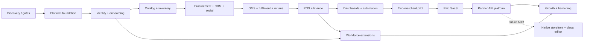

# CommerceOS — Engineering Execution Roadmap & Feature Delivery Playbook

**Companion ID:** COS-EXEC-031  
**Version:** 3.1 planning companion | **Prepared:** 24 November 2026  
**Status:** Implementation roadmap **only**, not evidence of built or tested software  
**Primary normative source:** `MASTER_BLUEPRINT.md` v3.0.1 (COS-MASTER-003, 24 November 2026)  
**Audience:** Product owner, architect, full-stack/QA/SRE/security engineers and coding agents.

> **Authority and conflicts.** `MASTER_BLUEPRINT.md` is the sole binding product/architecture specification. This roadmap decomposes its M00–M12 and M-F milestones into executable stories and verification tasks; it does not independently approve G-01…G-14, alter a master state machine, set a price/tax rate, or authorize a storefront launch. If this companion and the master differ, stop the affected story, record an ADR, approve and amend the master **first**, then adjust this plan. `AGENTS.md`, API contracts, migrations and tests remain derived artifacts. No requirements, routes, policies or release gates herein are claims of existing code.

## 1. Definition of the project and release boundaries

**Goal.** A separately registered merchant can operate a real retail/social business—from configuration and opening stock through enquiry, sales, payment, fulfilment, purchasing, returns, cash close, staff access and reports—using CommerceOS without manual database patches. The platform can onboard a second merchant without any cross-tenant disclosure. Later, it can bill merchants as SaaS and permit controlled custom-store API connections. Native storefront and drag/drop designer are deliberately **FUTURE (M-F)**.

**Tenant profiles for validation:** two independent Indian merchants, fashion/imitation jewellery and sarees, with physical/social sales. These are representative pilot fixtures, not justification for hardcoded categories or regulatory assumptions.

**Release bands:** P0 = controlled pilot; P1 = before paid commercialization or before advertised feature enablement; P2 = growth; F = native storefront and customer-facing UX; GATE = requires owner/legal/provider approval. Workforce payroll and transactional custom-store orders have special release gates RG6 and RG7.

**Successful order of operations:** a) establish secure foundation; b) make stock correct; c) make orders and collection correct; d) provide daily operational visibility; e) prove pilot on separate tenants; f) enable paid subscriptions; g) enable public/partner integrations subject to a separate readiness gate; h) advanced workforce/growth, with optional sequencing changes by approved ADR. No per-milestone completion claim without evidence.

## 2. Architecture to implement and retain

| Layer | Primary components | Boundary / responsibility |
|---|---|---|
| Applications | Business Web; Expo Business Mobile; tablet POS PWA; restricted Platform Admin | No direct database or privileged provider secrets in clients |
| API and policy | HTTPS gateway, authentication, tenant/branch authorization, DTO validation, NestJS modular monolith | One authoritative command surface with typed versioned API contracts |
| Commerce domains | Catalog/Pricing/Inventory, Procurement, CRM/Social, Orders/Fulfilment/Returns, Payments/Invoices/Cashbook | Module-owned invariants and transactional state; no duplicate OMS/catalog/stock |
| Platform domains | Onboarding/Imports, Workforce, Tasks/Automation, Reporting, Sales Channels, SaaS Billing, Audit | Permissioned workflows, tenant entitlements and independent platform billing |
| Transactional persistence | PostgreSQL with Prisma and durable outbox | Ledgers and money/stock/usage authority lives here, not Redis/cache |
| Asynchronous execution | Redis + BullMQ workers, outbox/inbox, retry/DLQ | At-least-once delivery with business-idempotent consumers |
| Adapters & infrastructure | Private object storage, secret manager, tracing/metrics, external email/payment/courier adapters | Providers can fail or be replaced without corrupting commerce transactions |

### 2.1 Technology and service boundaries

Apply the approved choices in [ADR-024](MASTER_BLUEPRINT.md#234-adr-024-businessos-engineering-toolchain) as their work items ship.

- **Monorepo:** pnpm + Turborepo; `apps/{api,worker,business-web,business-mobile,pos,platform-admin}` and `packages/{api-contracts,api-client,design-tokens,ui-web,config}`. Add `apps/storefront` only in M-F.
- **Business Web:** Next.js + TypeScript. Use shadcn/ui + Radix UI + Tailwind CSS for web UI, TanStack Query for API-backed state, React Hook Form + Zod for forms, and Zustand for shared UI-only state.
- **Backend:** NestJS module per domain with controller/DTO, application command and query, domain policy, repository and outbox adapter. Domain A may call Domain B only through a declared interface/facade; shared Prisma models do not confer ownership.
- **Persistence:** PostgreSQL authoritative; Prisma migrations and repositories; `BIGINT` paise for money and `DECIMAL` for quantity/tax. No float money, no direct client database traffic. Redis is never authoritative for financial, stock or usage states.
- **Worker:** Outbox written in the same DB transaction as domain records, then BullMQ at-least-once delivery to idempotent consumers. Use inbox dedupe, per-aggregate ordering/version checks when needed, DLQs, operator replay and alerting.
- **API:** typed OpenAPI, camelCase JSON, `/api/v1` staff, `/public/v1` limited catalog, `/partner/v1` strictly scoped integrations; structured error codes and request ID; pagination, request validation, rate limiting and idempotency on sensitive POST actions.
- **Infra:** Terraform for environment infrastructure, GitHub Actions for CI/CD, and OpenTelemetry for traces, metrics, and logs. Use OCI-compatible containers and adapters. Separate dev/staging/prod and configure TLS, secret management, database protection, object storage, backups, and cost controls. Verify available hosting capacity and cost before deployment.
- **Clients:** shared generated API contracts and semantic design tokens; no duplicated stock/pricing logic in frontend. Tablet POS is online-first; offline notes/drafts do not authorize offline stock or paid transitions.

### 2.2 Database boundaries and invariants

1. Every merchant record is tenant-bound; branch/location records require explicit branch-scoped authorization. A supplied tenant ID never overrides verified membership/credential context. Use composite tenant-safe FK constraints where practicable.
2. Stock is reconstructed from immutable movement ledger, with a transactionally maintained balance projection; reservations are separate commitments. Available = sellable on-hand less active commitments. A one-piece SKU must never be held twice.
3. Orders, payment allocations, fulfilment, shipment, returns and SaaS billing use separate aggregate transitions. External promises never mutate authoritative payment/stock states without validation.
4. Money movements, usage records, invoices, finalized payroll, audit and stock movements are immutable or append-only as appropriate. Corrections produce references and compensating events.
5. Financial collections and settlement are **not** the same: paid/collected is verified by its authority, and provider payout/fee settlement reconciled separately.
6. Event replay must not duplicate stock, charges, refunds, invoice sequences, notifications requiring dedupe, or metered usage.
7. PII, payroll, bank data and secrets must be protected at storage, API, UI, logs, search, exports, jobs and support console boundaries.
8. Catalog, inventory and OMS remain **native modules only**; no third-party catalog/inventory/order system integration replaces or dual-writes them. External payment/courier/messaging providers may plug into well-defined adapters.

## 3. How to develop **every** vertical slice

This is the mandatory sequence for all stories below. A story is not “done” because its controller returns `200`.

**Step A — Understand.** Map user story to master IDs; document actor, branch/tenant scope, allowed/forbidden transitions, edge cases, feature-plan entitlement, and unresolved gates. Draw one page of sequence/state diagram for high-risk financial/stock changes.

**Step B — Threat model.** Identify trust boundaries, object/field authorization, spoofed actor/tenant, replay/duplicate submission, race, IDOR, injection, PII/log disclosure, provider outage and abuse. Define relevant mitigations before coding.

**Step C — Contract-first.** Define typed request/response, validation, statuses/error codes, idempotency key, `expectedVersion`, result pagination, events/webhook schema and OpenAPI examples. Test backward compatibility and retry semantics.

**Step D — Database-first constraints, not DB-first delivery.** Add the smallest schema migration for that slice; tenant-safe FKs, unique/indexes/checks; make a rollback/backfill plan and seed test fixtures for Tenant A/B. Do not create every future table now.

**Step E — Application/domain.** Implement the smallest cohesive command/query paths with transaction boundaries, policy decisions, audit, outbox and idempotency. Never invoke external HTTP/payment provider inside the business DB transaction.

**Step F — Interface.** Implement list/detail/create/confirm and realistic loading/empty/error/permission/stale/conflict states on the relevant web/mobile/POS screen. Maintain accessibility (keyboard, labels, focus, screen reader), mobile responsiveness and English/Bengali-safe layout.

**Step G — Tests.** Unit-test rules and state transitions; integration-test real PostgreSQL constraints/transaction concurrency; API contract and permission tests; E2E scenario across UI where user-critical; negative/abuse/tenant isolation; load/failure/replay for critical paths. Test against a second tenant **on every entity**.

**Step H — Observability and rollout.** Add redacted structured logs, request/tenant correlation, domain metrics, dashboards/alerts, queue trace and runbook. Deploy behind flag/tenant cohort where appropriate; prove migration compatibility, rollback, reconciliation and no PII leakage.

**Step I — Evidence.** Link commit/PR, changed migration and OpenAPI diff, actual commands/results, UAT recording/screens, known risks, gate status, owner acceptance. A missing or failing test = not ready.

### 3.1 Definition of Done (DoD) — all feature stories

- Requirements traced to v3 master ID; no unresolved gate hidden; actor/tenant/branch access proven.
- API, DTO, DB constraints, generated client and UI all reflect one behavior; system errors are stable and actionable.
- Positive/negative paths tested using real DB when concurrency matters; idempotency and retry tested for mutations.
- Outbox, audit, logs and metrics added to high-risk writes; secrets/PII absent from logs and audit display.
- Migration plan, backward compatibility, downtime impact, data rollback and feature flag documented.
- Accessibility, responsive layout, empty/error states and status freshness verified where applicable.
- Tests genuinely executed in CI/staging; any skipped tests disclosed; dashboard/alert and runbook owner identified.
- Product/merchant signoff and release gate recorded when the story impacts commercial operations.

### 3.2 Mandatory quality-test matrix by feature criticality

| Feature class | Minimum tests and proof | Fault injection/abuse | Production gate |
|---|---|---|---|
| Identity/tenant/RBAC | Auth contract, privilege matrix, cross-tenant/branch IDOR, expired tokens | Forged tenant, privilege escalation, invitation replay, support override | RG1 and RG5 |
| Catalog/configuration | DTO/schema, visibility/permission, history, import validation | Unsafe media, huge payload, duplicate SKU, stale edits | P0 quality gate |
| Stock/holds/transfers | Ledger reconciliation, atomic concurrency, reservation TTL and audit | 50 simultaneous attempts on last unit; worker replay; deadlocks | RG2 |
| OMS/returns | State-machine model tests, partial qty, payment/stock interaction, UAT | Duplicate request, out-of-order event, cancel/dispatch race | RG2 |
| Payments/cash/tax | Allocation math, provider signature, immutable documents, cash variance | Duplicate paid/refund, delayed event, settlement mismatch, invoice race | RG2 + tax gate |
| Automations | Typed DSL, event replay, permission, quiet hours, throttling | Infinite loops, alert storm, provider timeout, cross-tenant event | Pilot/paid per channel |
| SaaS subscriptions | Entitlement matrix, immutable usage journal, overage and invoice replay | Duplicate fulfilment, two shipments, downgrade, disputed charge | RG4 |
| Partner API | BOLA/BFLA, rate limits, key revocation, webhook signatures and SSRF | Leaked key, guessed tenant ID, price mismatch, duplicate order | RG7 |
| Payroll | Deterministic calculation, effective-date snapshot, maker-checker, privacy | Employee reads peer salary, retroactive rerun, stale input | RG6 |
| Operations | Restore drill, SLO/load, secrets and backup audit | Queued outage, DB restart, failed migration, key compromise | RG5 |

## 4. Shared infrastructure and security engineering standards

### 4.1 Secure SDLC

- Use branch protection, required review, CODEOWNERS for auth/stock/payment/billing, no committed credentials, dependency and container image scanning, SAST, secret scans, lockfiles and signed/reproducible release artifacts where feasible.
- Apply the NIST SSDF framework for change control and secure engineering, OWASP ASVS 5.0 as an application control checklist, and OWASP API Security Top 10 (2023) for endpoint attack tests. Standards are guidance and **not evidence of certification**.
- Per module, explicitly test broken object-level and function-level authorization, mass assignment, business-flow abuse and unsafe API consumption. Pay special attention to worker permission context and signed file URLs.
- MFA for privileged accounts, secure session revocation, CSRF controls for cookie auth, safe CORS config, credential rotation, audit of configuration and impersonation, privacy retention and rights workflows.
- Dedicated platform operator identity and privileges. No general “superadmin can read everything” implementation; break-glass access time-limited and logged.

### 4.2 Scale safely without premature complexity

- Scale stateless API and worker processes horizontally while PostgreSQL remains the transaction authority. Tune pool size from connection and lock measurements. Add PgBouncer when measurements justify it and staging verifies Prisma and transaction compatibility. Use a direct database connection for migrations when pooling is enabled.
- Partition queue workloads by functional concern/priority and enforce per-tenant fairness; cap retries/TTL and DLQ expensive or poison jobs. Never retry non-idempotent side-effects blindly.
- Index by `(tenant_id, branch_id?, created_at)` and commonly filtered state/variant keys; verify query plans and query budget using representative dataset. Avoid `OFFSET` for large feeds; cursor-paginate.
- Caches/CDN only for read projections; invalidate on catalog/price/stock event with TTL fallback. Public availability is advisory; orders always re-check DB before allocation.
- Separate transactional read models/report workers from critical write paths; move to read replica/search/warehouse **only after** profiling and replication-lag semantics are defined.
- Design future service extraction seams via commands, events, ownership and access policies; do not split stock and orders into independent services before a consistency strategy is demonstrated.

### 4.3 Database, events and migrations

- Lock affected inventory location+SKU rows in deterministic order in short DB transactions, with a unique movement/operation key and bounded retry for serialization/deadlock errors. Verify ORM-specific guarantees in integration tests.
- Use `idempotency_keys` with actor/tenant/endpoint and request hash; store committed result and expiry policy. A changed payload with the same key returns a conflict.
- Store outbox record with domain write. Worker records `inbox_dedupes` before/atomically with each consumer effect; robust retries, timestamp/version logic and event schema evolution.
- Backward-compatible schema migrations follow expand → backfill → switch → contract; never rely on immediate mobile client upgrade. Use phased rollback, database snapshots and restore testing.
- Keep primary DB authoritative for transactional stock/collections; compare projections and ledger sums with scheduled audit jobs. Never “fix” drift by overwriting the ledger with the cache.

### 4.4 Observability, SLO and disaster recovery

- Use `requestId`, trace/span ID, tenant-safe identifier, authenticated actor and business operation ID on logs/metrics, without PII. Domain KPIs include reservations created/expired/consumed, stock reconciliation drift, collections mismatch, refund age, invoices failed, queue oldest age, usage ledger variance and webhook errors.
- Proposed pilot targets inherited from master: p95 authenticated reads <500 ms, p95 critical transactions <1.5s under an **approved measured workload**, 50 contending requests for final SKU correctness, jobs usually processed within 60 seconds in normal conditions, and 99.5% pilot availability objective (not contractual commitments).
- Backup/restore: encrypted DB backups, object-store backup/versioning, PITR where available, recovery environment, tenant integrity checks, tested runbook. Master proposes pilot RPO/RTO 24h **only if proved**, with stricter paid-release targets subject to G-11.
- Incident playbooks: compromised key, unauthorized access, stock drift, missing money, duplicate webhook, delayed shipment, stuck worker, migration failure, backup restore, subscription billing mismatch. Set named responders and thresholds based on observed pilot telemetry; no fabricated alerts.

## 5. Dependency map and recommended release order



**Critical path:** M00→M08 for reliable pilot; M09 + RG4 + RG5 for paid SaaS; M10/RG7 only for transactional custom storefront capability. M11 can be reordered only by signed ADR and prerequisites. API/channel *design* begins in M01/M02 but public integration runtime is not prematurely published.

**Parallelizable work:** UX wireframes and accessibility tokens while APIs/DB mature; entity schemas and contract tests within one agreed domain; platform observability alongside early slices. Never parallel-write shared stock/payment states without a documented coordination protocol.


## 6. Feature-by-feature implementation plan — 123 individually verifiable stories

Each numbered story is a *work item*, not an already implemented feature. The feature sequence below is deliberately explicit: domain steps, data/API/UI contract, risk+scale checks and acceptance evidence. The universal development steps in Section 3 apply to **every** item. Stories may be split further but should never be merged into a giant uncontrolled coding-agent request.


### M00 — Discovery, workflows, contracts and policy decisions

**Release band:** P0 design  
**Depends on:** —  
**Exit gate:** RG0  
**Milestone outcome:** Approved business process maps, responsibility owners, signed open-gate plan and first 12 UAT scenario definitions.

**Recommended sequence:** M00.01 → M00.02 → M00.03 → M00.04 → M00.05 → M00.06.


#### M00.01 — Merchant process discovery

*Master mapping:* `3,5; SC-01…SC-06`.

1. **Implementation steps:** Observe/record jewellery and saree workflows; document order, cash, purchase and return exceptions; create as-is/to-be process swimlanes; agree pilot data types.

2. **Data, APIs, events and UX:** Produce workflow map, actor matrix, exception examples, screen list; no code.

3. **Security, concurrency, reliability and scale:** Do not assume merchant tax, jewellery hallmark, delivery method, or working hours; keep personal customer data out of discovery fixtures.

4. **Acceptance evidence:** Two merchant representatives sign workflow examples and backlog trace.

5. **Ship check:** Apply the relevant Section 3 DoD. For code stories attach actual unit/integration/tenant-isolation results, E2E/fault tests where relevant, migration/rollback, contract diffs and telemetry. For discovery/design stories attach signed artifacts and review evidence instead; never fabricate execution results.


#### M00.02 — Domain boundaries and ownership

*Master mapping:* `16,17,23`.

1. **Implementation steps:** Map ownership of Catalog, Inventory, Order, Payment, Return, SaaS Billing and HR; define legal commands/events and prohibited direct table writes; register ADRs.

2. **Data, APIs, events and UX:** Produce context map, bounded-context interfaces, dependency rules; sample payloads.

3. **Security, concurrency, reliability and scale:** Test ownership logic against refund, dispatch, reservation expiry and subscription billing; reject circular dependencies.

4. **Acceptance evidence:** Architect review approves domain ownership and integration sequence.

5. **Ship check:** Apply the relevant Section 3 DoD. For code stories attach actual unit/integration/tenant-isolation results, E2E/fault tests where relevant, migration/rollback, contract diffs and telemetry. For discovery/design stories attach signed artifacts and review evidence instead; never fabricate execution results.


#### M00.03 — State machines and invariants

*Master mapping:* `6,8,10,13`.

1. **Implementation steps:** Define states, commands, actors, transitions, failure paths and compensation for order/payment/fulfilment/shipment/RMA/reservation/PO/subscription.

2. **Data, APIs, events and UX:** State diagrams, transition tables, idempotency policy, source-of-truth mapping.

3. **Security, concurrency, reliability and scale:** Model duplicate, out-of-order, concurrent cancellation, partial receipt, RTO and disputes before schema implementation.

4. **Acceptance evidence:** Model-based test cases and impossible-state checklist signed.

5. **Ship check:** Apply the relevant Section 3 DoD. For code stories attach actual unit/integration/tenant-isolation results, E2E/fault tests where relevant, migration/rollback, contract diffs and telemetry. For discovery/design stories attach signed artifacts and review evidence instead; never fabricate execution results.


#### M00.04 — Threat model and permission matrix

*Master mapping:* `3,20; G-01/G-12`.

1. **Implementation steps:** Identify trust boundaries for owner, employee, cashier, operator, API key and worker; enumerate object/action/field rights by branch/tenant; plan privacy and retention.

2. **Data, APIs, events and UX:** Permission workbook, attack tree, security risk register, data classification.

3. **Security, concurrency, reliability and scale:** Include IDOR/BOLA, file-link leakage, forged webhook, cross-tenant FK, role escalation and compromised support access.

4. **Acceptance evidence:** Security reviewer approves matrix and explicit deny tests.

5. **Ship check:** Apply the relevant Section 3 DoD. For code stories attach actual unit/integration/tenant-isolation results, E2E/fault tests where relevant, migration/rollback, contract diffs and telemetry. For discovery/design stories attach signed artifacts and review evidence instead; never fabricate execution results.


#### M00.05 — Policy and legal decision gates

*Master mapping:* `23.3 G-01…G-14`.

1. **Implementation steps:** Assign accountable owner/due-before-milestone for each gate; capture default policy and blocked capability; get GST, payment and payroll validation paths.

2. **Data, APIs, events and UX:** `DECISIONS_LOG.md`, ADR template and feature approval checklist.

3. **Security, concurrency, reliability and scale:** Never allow coding agent to substitute a GST rate, merchant plan price, OTP provider or payment evidence policy.

4. **Acceptance evidence:** RG0 list shows APPROVED or BLOCKED per gated decision.

5. **Ship check:** Apply the relevant Section 3 DoD. For code stories attach actual unit/integration/tenant-isolation results, E2E/fault tests where relevant, migration/rollback, contract diffs and telemetry. For discovery/design stories attach signed artifacts and review evidence instead; never fabricate execution results.


#### M00.06 — QA architecture and SLO workload

*Master mapping:* `4,16.6,21`.

1. **Implementation steps:** Create two-tenant fixtures, realistic SKU/order volumes and retry matrix; define performance/load environment; establish UAT scenario ownership and operational staffing.

2. **Data, APIs, events and UX:** Test suite map SC-01…SC-12, baseline SLO worksheet, metrics catalog.

3. **Security, concurrency, reliability and scale:** Treat v3 response-time, load and RPO/RTO numbers as targets requiring measured conditions, not guaranteed production KPIs.

4. **Acceptance evidence:** RG0 includes test data design, workload plan and reviewer assignments.

5. **Ship check:** Apply the relevant Section 3 DoD. For code stories attach actual unit/integration/tenant-isolation results, E2E/fault tests where relevant, migration/rollback, contract diffs and telemetry. For discovery/design stories attach signed artifacts and review evidence instead; never fabricate execution results.


### M01 — Engineering platform, secure SDLC and event backbone

**Release band:** P0  
**Depends on:** M00  
**Exit gate:** Platform baseline  
**Milestone outcome:** Reproducible monorepo/CI/staging, tenant context, storage, outbox, secrets and deploy/restore runbooks.

**Recommended sequence:** M01.01 → M01.02 → M01.03 → M01.04 → M01.05 → M01.06 → M01.07 → M01.08 → M01.09 → M01.10.


#### M01.01 — Repo structure and package boundaries

*Master mapping:* `16.1,22`.

1. **Implementation steps:** Initialize pnpm/Turborepo with independent app builds and strict TypeScript. Create the API, worker, Next.js Business Web, mobile, POS, and admin shells, shared typed packages, and CODEOWNERS. Apply ADR-024 to included web tooling.

2. **Data, APIs, events and UX:** Scaffold repository and package dependency graph; no working storefront code.

3. **Security, concurrency, reliability and scale:** Add lint rule forbidding cross-module private imports and circular dependencies; lock dependency versions.

4. **Acceptance evidence:** Fresh checkout installs and runs typed builds with no secrets.

5. **Ship check:** Apply the relevant Section 3 DoD. For code stories attach actual unit/integration/tenant-isolation results, E2E/fault tests where relevant, migration/rollback, contract diffs and telemetry. For discovery/design stories attach signed artifacts and review evidence instead; never fabricate execution results.


#### M01.02 — Local development and test environments

*Master mapping:* `16,21`.

1. **Implementation steps:** Build reproducible Docker Compose for API, PostgreSQL, Redis and object-storage stub; seed Tenant A/B; script reset/reseed; staging deploy documentation.

2. **Data, APIs, events and UX:** `.env.example`, docker profiles, isolated test DB and migrations command.

3. **Security, concurrency, reliability and scale:** No real PII or secrets in fixtures, no production DB connectivity from local tests; readiness and health endpoints.

4. **Acceptance evidence:** One command boots local environment; API and queue smoke tests pass.

5. **Ship check:** Apply the relevant Section 3 DoD. For code stories attach actual unit/integration/tenant-isolation results, E2E/fault tests where relevant, migration/rollback, contract diffs and telemetry. For discovery/design stories attach signed artifacts and review evidence instead; never fabricate execution results.


#### M01.03 — HTTP contract, validation and API client

*Master mapping:* `18`.

1. **Implementation steps:** Define `/api/v1`, DTO validation, structured errors, X-Request-Id, cursor pagination, ETag/version, idempotency header; generate OpenAPI and TS clients.

2. **Data, APIs, events and UX:** Shared `api-contracts` and `api-client`; global guards/interceptors/exception filters.

3. **Security, concurrency, reliability and scale:** Reject unknown privileged fields (mass assignment); max payload/timeout; schema diff check in CI.

4. **Acceptance evidence:** Supertest with OpenAPI contract validation proves HTTP errors, authorization, retries, pagination, and compatibility.

5. **Ship check:** Apply the relevant Section 3 DoD. For code stories attach actual unit/integration/tenant-isolation results, E2E/fault tests where relevant, migration/rollback, contract diffs and telemetry. For discovery/design stories attach signed artifacts and review evidence instead; never fabricate execution results.


#### M01.04 — Database migrations and transaction toolkit

*Master mapping:* `16.3,17`.

1. **Implementation steps:** Establish Prisma migration strategy, UUID/timestamps/concurrency pattern, decimal/money primitives, transactional command wrapper and tenant-safe FK examples.

2. **Data, APIs, events and UX:** Migration runner, seed scripts, schema checks, transaction retry utility.

3. **Security, concurrency, reliability and scale:** Index tenant/branch access; test lock contention, deadlocks and rollback; no generic unsafe repository finder.

4. **Acceptance evidence:** CI applies all migrations to an empty PostgreSQL database via Testcontainers and validates a repeatable rollback plan.

5. **Ship check:** Apply the relevant Section 3 DoD. For code stories attach actual unit/integration/tenant-isolation results, E2E/fault tests where relevant, migration/rollback, contract diffs and telemetry. For discovery/design stories attach signed artifacts and review evidence instead; never fabricate execution results.


#### M01.05 — Tenant and branch execution context plumbing

*Master mapping:* `16.2,20`.

1. **Implementation steps:** Define signed/verified principal context injectable in HTTP and jobs; put tenant/branch scope behind repository filters; deny queries lacking context; enforce composed authorization.

2. **Data, APIs, events and UX:** AuthContext/RequestContext types; guard and query policy; audit metadata propagation.

3. **Security, concurrency, reliability and scale:** Cross-tenant guessed IDs and worker context leaks must be impossible; platform operations use distinct trust boundary.

4. **Acceptance evidence:** Tenant A/B isolation smoke test prevents any cross-tenant read/write.

5. **Ship check:** Apply the relevant Section 3 DoD. For code stories attach actual unit/integration/tenant-isolation results, E2E/fault tests where relevant, migration/rollback, contract diffs and telemetry. For discovery/design stories attach signed artifacts and review evidence instead; never fabricate execution results.


#### M01.06 — Transactional outbox and worker foundation

*Master mapping:* `16.3,12,21`.

1. **Implementation steps:** Implement business transaction + outbox insert atomically; dispatcher polls/locks outbox; consumer inbox dedupe; retries/backoff/DLQ; operator-safe replay path.

2. **Data, APIs, events and UX:** `outbox_events`, `inbox_dedupes`, job log and worker dashboards; sample event.

3. **Security, concurrency, reliability and scale:** Crash after commit, repeated delivery and bad payload cannot double-effect; record schema/event versions and key ordering.

4. **Acceptance evidence:** Simulated crash/replay produces exactly one consumer side effect per event semantics.

5. **Ship check:** Apply the relevant Section 3 DoD. For code stories attach actual unit/integration/tenant-isolation results, E2E/fault tests where relevant, migration/rollback, contract diffs and telemetry. For discovery/design stories attach signed artifacts and review evidence instead; never fabricate execution results.


#### M01.07 — Authentication, secrets and protected configuration base

*Master mapping:* `20; G-01`.

1. **Implementation steps:** Wire an auth-provider adapter, secret-store interface and environment validation; enforce safe cookie/token choices, CSRF and secure headers appropriate to transport.

2. **Data, APIs, events and UX:** Provider-neutral auth interface, secret refs, log redaction and config loader.

3. **Security, concurrency, reliability and scale:** Rotate test keys; fail closed without configured secret; do not hardcode SMS or security provider.

4. **Acceptance evidence:** CI secret scan, session security smoke and rotation simulation.

5. **Ship check:** Apply the relevant Section 3 DoD. For code stories attach actual unit/integration/tenant-isolation results, E2E/fault tests where relevant, migration/rollback, contract diffs and telemetry. For discovery/design stories attach signed artifacts and review evidence instead; never fabricate execution results.


#### M01.08 — File object and background jobs infrastructure

*Master mapping:* `17,20`.

1. **Implementation steps:** Design authorized upload intents, object metadata, private storage, expiring signed download URLs and async scan/resize hooks; status/cancel endpoints for long tasks.

2. **Data, APIs, events and UX:** `file_objects`, storage adapter, job progress API.

3. **Security, concurrency, reliability and scale:** Validate MIME/content, size, ownership, filenames, malware scanning and tenant-safe signed URLs; bound uploads/egress.

4. **Acceptance evidence:** Cross-tenant file denial and expired URL tests pass.

5. **Ship check:** Apply the relevant Section 3 DoD. For code stories attach actual unit/integration/tenant-isolation results, E2E/fault tests where relevant, migration/rollback, contract diffs and telemetry. For discovery/design stories attach signed artifacts and review evidence instead; never fabricate execution results.


#### M01.09 — CI/CD, supply chain and feature flags

*Master mapping:* `20,21`.

1. **Implementation steps:** Use GitHub Actions for lint, typecheck, tests, dependency scans, SAST, image build, provenance, and gated staging deployment. Use Terraform for environment infrastructure changes. Add audited flag and rollout-cohort control.

2. **Data, APIs, events and UX:** CI matrix, release artifact, migration job and flag evaluation contract.

3. **Security, concurrency, reliability and scale:** No prod deploy on failing guard; stage schema backward-compatible and rollback drill documented.

4. **Acceptance evidence:** Build→staging deploy→smoke→rollback demonstrated.

5. **Ship check:** Apply the relevant Section 3 DoD. For code stories attach actual unit/integration/tenant-isolation results, E2E/fault tests where relevant, migration/rollback, contract diffs and telemetry. For discovery/design stories attach signed artifacts and review evidence instead; never fabricate execution results.


#### M01.10 — Metrics, tracing and operational baseline

*Master mapping:* `16.6,21`.

1. **Implementation steps:** Instrument HTTP, Prisma/DB, Redis/jobs, domain event and API errors; define redacted structured logging; dashboards, SLO proposals and incident owners.

2. **Data, APIs, events and UX:** OpenTelemetry instrumentation, `/health`, `/ready`, alert routing and runbooks.

3. **Security, concurrency, reliability and scale:** Avoid raw auth tokens, passwords, PII, bank refs in logs; cardinality budgets by tenant; alert thresholds based on observed data.

4. **Acceptance evidence:** Failed queue/DB scenarios appear in metrics and can be traced to owner.

5. **Ship check:** Apply the relevant Section 3 DoD. For code stories attach actual unit/integration/tenant-isolation results, E2E/fault tests where relevant, migration/rollback, contract diffs and telemetry. For discovery/design stories attach signed artifacts and review evidence instead; never fabricate execution results.


### M02 — Identity, tenant RBAC, guided onboarding and imports

**Release band:** P0  
**Depends on:** M01  
**Exit gate:** RG1  
**Milestone outcome:** Owner and staff can create secure isolated merchants, complete setup and import opening data.

**Recommended sequence:** M02.01 → M02.02 → M02.03 → M02.04 → M02.05 → M02.06 → M02.07 → M02.08 → M02.09 → M02.10 → M02.11.


#### M02.01 — Owner registration, login and account recovery

*Master mapping:* `OWN-001; G-01`.

1. **Implementation steps:** Implement chosen verified identity flow, login/logout/refresh, rate limits, locked-account recovery, privileged MFA and session revocation.

2. **Data, APIs, events and UX:** User/identity/session tables, auth endpoints and responsive auth views.

3. **Security, concurrency, reliability and scale:** No account enumeration, OTP guessing, insecure refresh reuse or persistent bearer tokens in localStorage.

4. **Acceptance evidence:** Owner verification and revoked-session replay tests pass.

5. **Ship check:** Apply the relevant Section 3 DoD. For code stories attach actual unit/integration/tenant-isolation results, E2E/fault tests where relevant, migration/rollback, contract diffs and telemetry. For discovery/design stories attach signed artifacts and review evidence instead; never fabricate execution results.


#### M02.02 — Tenant creation and membership switching

*Master mapping:* `OWN-001,16.2`.

1. **Implementation steps:** Add draft tenant creation, verified owner membership, tenant switch and membership status; server derives context from current verified membership.

2. **Data, APIs, events and UX:** `tenants`, `memberships`, `/me/memberships`, `POST /tenants`.

3. **Security, concurrency, reliability and scale:** Actor with two merchants cannot leak data across selected context or reuse URL tenant IDs.

4. **Acceptance evidence:** Tenant A/B switch preserves strict isolation across API, caches and jobs.

5. **Ship check:** Apply the relevant Section 3 DoD. For code stories attach actual unit/integration/tenant-isolation results, E2E/fault tests where relevant, migration/rollback, contract diffs and telemetry. For discovery/design stories attach signed artifacts and review evidence instead; never fabricate execution results.


#### M02.03 — Branches, stock locations and registers

*Master mapping:* `3, OWN-003`.

1. **Implementation steps:** Create first and additional branch, warehouse/location and optional register; constrain default branch and cross-branch grants.

2. **Data, APIs, events and UX:** Branch/location entities and settings screens; scoped CRUD.

3. **Security, concurrency, reliability and scale:** Prevent attaching location of Tenant B, deleting branch with active business references, unauthorized cross-branch transfers.

4. **Acceptance evidence:** Cashier sees own branch; owner can manage branch under plan entitlement.

5. **Ship check:** Apply the relevant Section 3 DoD. For code stories attach actual unit/integration/tenant-isolation results, E2E/fault tests where relevant, migration/rollback, contract diffs and telemetry. For discovery/design stories attach signed artifacts and review evidence instead; never fabricate execution results.


#### M02.04 — RBAC/ABAC and permission administration

*Master mapping:* `3,16.2,20`.

1. **Implementation steps:** Implement role templates, action/resource/scope checks, branch grants, approval limits, protected superuser permissions and no privilege escalation on assignment.

2. **Data, APIs, events and UX:** Roles/grants/membership tables, `/me/permissions`, role UI.

3. **Security, concurrency, reliability and scale:** Server denies forbidden fields and nested relations, not only hidden UI; audit role changes and self-elevation.

4. **Acceptance evidence:** Full actor x action x branch matrix runs in integration tests.

5. **Ship check:** Apply the relevant Section 3 DoD. For code stories attach actual unit/integration/tenant-isolation results, E2E/fault tests where relevant, migration/rollback, contract diffs and telemetry. For discovery/design stories attach signed artifacts and review evidence instead; never fabricate execution results.


#### M02.05 — Business identity, legal profile and settings versioning

*Master mapping:* `OWN-003/006; G-06`.

1. **Implementation steps:** Add business name, addresses, locale/timezone, tax posture flags, bank instructions, invoice/payment preferences and effective-dated config history.

2. **Data, APIs, events and UX:** Config version tables, settings routes, validation and audit diff UI.

3. **Security, concurrency, reliability and scale:** Enforce sensitive field masking, maker-checker where required and immutable historical policy snapshots.

4. **Acceptance evidence:** Config change impacts future documents without rewriting history.

5. **Ship check:** Apply the relevant Section 3 DoD. For code stories attach actual unit/integration/tenant-isolation results, E2E/fault tests where relevant, migration/rollback, contract diffs and telemetry. For discovery/design stories attach signed artifacts and review evidence instead; never fabricate execution results.


#### M02.06 — Ten-step resumable onboarding wizard

*Master mapping:* `OWN-002/003/007`.

1. **Implementation steps:** Build server-backed progress state with 10 v3 steps, prerequisites, save/resume/skip optional, readiness validation and authorized activation.

2. **Data, APIs, events and UX:** `onboarding_flows/steps`, `/onboarding/*`, desktop/mobile friendly screens.

3. **Security, concurrency, reliability and scale:** Prevent public exposure of draft tenant; block activation for mandatory payment/invoice/stock gaps but do not force future channels.

4. **Acceptance evidence:** SC-01 passes across logout, rejected import and go-live validation.

5. **Ship check:** Apply the relevant Section 3 DoD. For code stories attach actual unit/integration/tenant-isolation results, E2E/fault tests where relevant, migration/rollback, contract diffs and telemetry. For discovery/design stories attach signed artifacts and review evidence instead; never fabricate execution results.


#### M02.07 — Import Center: mapping and dry run

*Master mapping:* `OWN-004`.

1. **Implementation steps:** Support CSV/XLSX safe ingestion, column mapping, row validation, duplicate SKU detection, dry-run preview and rejected-row download for products/variants/stock/customers/suppliers.

2. **Data, APIs, events and UX:** `import_jobs/rows/mappings` and staged files, async preview API.

3. **Security, concurrency, reliability and scale:** File quarantine, formula injection protection on CSV export, encoding controls, per-tenant quotas and memory bounds.

4. **Acceptance evidence:** 10k-row import preview tested with malformed, duplicate and cross-tenant references.

5. **Ship check:** Apply the relevant Section 3 DoD. For code stories attach actual unit/integration/tenant-isolation results, E2E/fault tests where relevant, migration/rollback, contract diffs and telemetry. For discovery/design stories attach signed artifacts and review evidence instead; never fabricate execution results.


#### M02.08 — Import commit, idempotency and opening balances

*Master mapping:* `OWN-004, INV-002`.

1. **Implementation steps:** Implement chunked commit with row provenance, resumable jobs, explicit partial acceptance, opening stock ledger command and safe compensation where already referenced.

2. **Data, APIs, events and UX:** Import worker, commit endpoint, import row statuses, opening movement/source key.

3. **Security, concurrency, reliability and scale:** Replayed import cannot create duplicate SKUs or double-count stock; rollback forbidden for referenced financial records.

4. **Acceptance evidence:** SC-01 import behavior and import replay/partial failures pass.

5. **Ship check:** Apply the relevant Section 3 DoD. For code stories attach actual unit/integration/tenant-isolation results, E2E/fault tests where relevant, migration/rollback, contract diffs and telemetry. For discovery/design stories attach signed artifacts and review evidence instead; never fabricate execution results.


#### M02.09 — Employee invites and assignment baseline

*Master mapping:* `WF-001; OWN-003`.

1. **Implementation steps:** Invite staff, link employee record to optional identity, assign branches/roles and revoke access; preserve historic order attribution after termination.

2. **Data, APIs, events and UX:** Invites, employees, branch assignments and role UI.

3. **Security, concurrency, reliability and scale:** Invite expiry/reuse, stolen link, revoked sessions, salary fields hidden from cashier.

4. **Acceptance evidence:** Staff can operate permitted branch after invite and loses access on revocation.

5. **Ship check:** Apply the relevant Section 3 DoD. For code stories attach actual unit/integration/tenant-isolation results, E2E/fault tests where relevant, migration/rollback, contract diffs and telemetry. For discovery/design stories attach signed artifacts and review evidence instead; never fabricate execution results.


#### M02.10 — Auditing and permissioned history

*Master mapping:* `4,20`.

1. **Implementation steps:** Capture actor, reason, before/after safe diff, request ID and related business document for all sensitive settings/roles/stock/payment operations; build scoped viewer.

2. **Data, APIs, events and UX:** Append-only `audit_logs`, `/audit-logs`, filter/export.

3. **Security, concurrency, reliability and scale:** Redact bank/secrets/payroll, immutable writes, support access by explicit grant, secured export URLs.

4. **Acceptance evidence:** Tampering attempt denied; each privileged change traceable to actor and time.

5. **Ship check:** Apply the relevant Section 3 DoD. For code stories attach actual unit/integration/tenant-isolation results, E2E/fault tests where relevant, migration/rollback, contract diffs and telemetry. For discovery/design stories attach signed artifacts and review evidence instead; never fabricate execution results.


#### M02.11 — Merchant data export and privacy controls skeleton

*Master mapping:* `5,20; G-12`.

1. **Implementation steps:** Define export authorization, subject-rights workflow, retention classes and business deletion/suspension policy; generate permissioned baseline export job.

2. **Data, APIs, events and UX:** `report_jobs/audit_exports`, structured CSV/JSON and download status.

3. **Security, concurrency, reliability and scale:** PII in downloads encrypted/short-lived; test deletion request versus legal retention hold.

4. **Acceptance evidence:** Owner exports own data; Tenant B cannot access output; policy gates recorded.

5. **Ship check:** Apply the relevant Section 3 DoD. For code stories attach actual unit/integration/tenant-isolation results, E2E/fault tests where relevant, migration/rollback, contract diffs and telemetry. For discovery/design stories attach signed artifacts and review evidence instead; never fabricate execution results.


### M03 — Catalog, pricing, inventory ledger and stock control

**Release band:** P0  
**Depends on:** M02  
**Exit gate:** RG2 stock evidence  
**Milestone outcome:** Final-unit reservations are atomic; product/price/ledger, counts and transfers reconcile.

**Recommended sequence:** M03.01 → M03.02 → M03.03 → M03.04 → M03.05 → M03.06 → M03.07 → M03.08 → M03.09 → M03.10.


#### M03.01 — Category taxonomy and typed attributes

*Master mapping:* `CAT-001/002`.

1. **Implementation steps:** Model hierarchical categories, typed attributes, required per category, labels/translations and merchant-variant presets; support jewellery/saree templates as optional configuration.

2. **Data, APIs, events and UX:** Category/attribute schema, validation API and admin UI.

3. **Security, concurrency, reliability and scale:** Prevent category loops, unauthorized edits and unsafe HTML; index parent/path and tenant.

4. **Acceptance evidence:** Two different merchant taxonomies coexist and export without interference.

5. **Ship check:** Apply the relevant Section 3 DoD. For code stories attach actual unit/integration/tenant-isolation results, E2E/fault tests where relevant, migration/rollback, contract diffs and telemetry. For discovery/design stories attach signed artifacts and review evidence instead; never fabricate execution results.


#### M03.02 — Products, variants and SKU lifecycle

*Master mapping:* `CAT-001/003`.

1. **Implementation steps:** Add product draft→active→archived, variants, unique normalized SKU, tags, search filters, historical archival protections and one-piece stock setting.

2. **Data, APIs, events and UX:** Products/variants tables and list/detail/create/edit APIs.

3. **Security, concurrency, reliability and scale:** Enforce `(tenant_id, normalized_sku)` uniqueness at DB layer and optimistic version to prevent concurrent SKU collisions.

4. **Acceptance evidence:** Parallel SKU creation returns conflict; archived product remains visible in historic order snapshot.

5. **Ship check:** Apply the relevant Section 3 DoD. For code stories attach actual unit/integration/tenant-isolation results, E2E/fault tests where relevant, migration/rollback, contract diffs and telemetry. For discovery/design stories attach signed artifacts and review evidence instead; never fabricate execution results.


#### M03.03 — Product media and search

*Master mapping:* `CAT-001/003`.

1. **Implementation steps:** Implement upload intent, scan, resize, alt text and stable media references; build indexed product search and cursor pagination.

2. **Data, APIs, events and UX:** File storage adapter, media entities, product search endpoints.

3. **Security, concurrency, reliability and scale:** Strip unsafe metadata, signed URLs, enforce ownership, prevent SSRF via external image imports.

4. **Acceptance evidence:** Large catalog search/load and tenant-safe image access validated.

5. **Ship check:** Apply the relevant Section 3 DoD. For code stories attach actual unit/integration/tenant-isolation results, E2E/fault tests where relevant, migration/rollback, contract diffs and telemetry. For discovery/design stories attach signed artifacts and review evidence instead; never fabricate execution results.


#### M03.04 — Pricing, tax display and discount controls

*Master mapping:* `PRC-001/002; G-06`.

1. **Implementation steps:** Store price schedules, optional branch/channel price book, tax-inclusive flag, price version and cost snapshot; implement server pricing evaluator with explicit rounding/discount ordering.

2. **Data, APIs, events and UX:** Price tables, pricing service/preview API and price-edit UI.

3. **Security, concurrency, reliability and scale:** No client-enforced discount limits or altered price in order; preserve historic price; audited privileged override.

4. **Acceptance evidence:** Quote and later confirmed order price match current policy or show explicit price-change conflict.

5. **Ship check:** Apply the relevant Section 3 DoD. For code stories attach actual unit/integration/tenant-isolation results, E2E/fault tests where relevant, migration/rollback, contract diffs and telemetry. For discovery/design stories attach signed artifacts and review evidence instead; never fabricate execution results.


#### M03.05 — Stock movement ledger and projections

*Master mapping:* `INV-001/002`.

1. **Implementation steps:** Add append-only movement journal, per-SKU/location balance projection, authorized opening/receipt/issue/adjustment command, reconciliation math and audit.

2. **Data, APIs, events and UX:** `stock_movements`, `stock_balances`, command endpoints and read grids.

3. **Security, concurrency, reliability and scale:** Transactional balance update with movement source uniqueness; tenant-safe FK and short lock.

4. **Acceptance evidence:** Journal replay matches balances and corrections cannot directly edit old movements.

5. **Ship check:** Apply the relevant Section 3 DoD. For code stories attach actual unit/integration/tenant-isolation results, E2E/fault tests where relevant, migration/rollback, contract diffs and telemetry. For discovery/design stories attach signed artifacts and review evidence instead; never fabricate execution results.


#### M03.06 — Reservation and release state machine

*Master mapping:* `INV-003`.

1. **Implementation steps:** Reserve available SKU in DB transaction; release/consume/expire with unique business source, TTL and separate on-hand/held calculations; use DB locking or proven atomic CAS.

2. **Data, APIs, events and UX:** Reservations, stock availability API and expiry job; conflict/status UI.

3. **Security, concurrency, reliability and scale:** 50 concurrent reservations for one unit yield one winner; retries, cancel/convert race and worker crash not oversell.

4. **Acceptance evidence:** INV-AC1/2 and SC-02 pass with ledger reconciliation.

5. **Ship check:** Apply the relevant Section 3 DoD. For code stories attach actual unit/integration/tenant-isolation results, E2E/fault tests where relevant, migration/rollback, contract diffs and telemetry. For discovery/design stories attach signed artifacts and review evidence instead; never fabricate execution results.


#### M03.07 — Stock adjustments and quarantine

*Master mapping:* `INV-002/004`.

1. **Implementation steps:** Implement reason-coded correction, damaged/write-off/quarantine disposition, approval threshold and compensating movement.

2. **Data, APIs, events and UX:** Adjustment requests/approvals, quarantine stock and stock journal UI.

3. **Security, concurrency, reliability and scale:** Maker-checker for large write-offs, no direct balance writes, strict stock-visibility policy.

4. **Acceptance evidence:** Damaged restock never changes sellable count; approved correction auditable.

5. **Ship check:** Apply the relevant Section 3 DoD. For code stories attach actual unit/integration/tenant-isolation results, E2E/fault tests where relevant, migration/rollback, contract diffs and telemetry. For discovery/design stories attach signed artifacts and review evidence instead; never fabricate execution results.


#### M03.08 — Physical counts and cycle counts

*Master mapping:* `INV-004`.

1. **Implementation steps:** Capture count session, expected snapshot, blind count, discrepancy summary, supervisor approval, approved journal corrections; support partial session resume.

2. **Data, APIs, events and UX:** Count/countLine entities, count endpoints, tablet UI.

3. **Security, concurrency, reliability and scale:** Prevent stale count overwriting later sale; serialize/post variance with expected version and reassessment.

4. **Acceptance evidence:** Count differences reconcile without losing intervening movements.

5. **Ship check:** Apply the relevant Section 3 DoD. For code stories attach actual unit/integration/tenant-isolation results, E2E/fault tests where relevant, migration/rollback, contract diffs and telemetry. For discovery/design stories attach signed artifacts and review evidence instead; never fabricate execution results.


#### M03.09 — Inter-branch stock transfer

*Master mapping:* `INV-004`.

1. **Implementation steps:** Implement request/approval/pick/dispatch/in-transit/partial receipt/cancel/exception workflow; record both movement legs at agreed business transition.

2. **Data, APIs, events and UX:** Transfers/lines and transfer commands, stock in transit dashboard.

3. **Security, concurrency, reliability and scale:** Never expose source inventory after dispatch or destination availability before receipt; tenant/branch permissions checked both sides.

4. **Acceptance evidence:** INV-AC4 plus partial/damaged transit test passes.

5. **Ship check:** Apply the relevant Section 3 DoD. For code stories attach actual unit/integration/tenant-isolation results, E2E/fault tests where relevant, migration/rollback, contract diffs and telemetry. For discovery/design stories attach signed artifacts and review evidence instead; never fabricate execution results.


#### M03.10 — Low-stock settings and stock reconciliation worker

*Master mapping:* `INV-005`.

1. **Implementation steps:** Build per-location thresholds, low stock query, ledger-vs-balance audit job, drift alerts and authorized investigation workflow.

2. **Data, APIs, events and UX:** Thresholds/read models, scheduled verifier and alert metrics.

3. **Security, concurrency, reliability and scale:** Index location/SKU and bound job page size; do not silently repair drift; route reconciliation incidents to operator.

4. **Acceptance evidence:** Intentional projection corruption detected, quarantined and explained.

5. **Ship check:** Apply the relevant Section 3 DoD. For code stories attach actual unit/integration/tenant-isolation results, E2E/fault tests where relevant, migration/rollback, contract diffs and telemetry. For discovery/design stories attach signed artifacts and review evidence instead; never fabricate execution results.


### M04 — Suppliers, purchasing, customers, CRM and social selling

**Release band:** P0/P1 supplier payables  
**Depends on:** M03  
**Exit gate:** RG2 domain evidence  
**Milestone outcome:** Social/customer/PO flows produce valid native stock and customer histories.

**Recommended sequence:** M04.01 → M04.02 → M04.03 → M04.04 → M04.05 → M04.06 → M04.07 → M04.08 → M04.09 → M04.10.


#### M04.01 — Supplier directory and payment terms

*Master mapping:* `PUR-001`.

1. **Implementation steps:** Add supplier identity, contacts, branch links, optional tax identifiers, lead time, payment terms, status and notes; support lookup and export.

2. **Data, APIs, events and UX:** Supplier table, CRUD/search, vendor view.

3. **Security, concurrency, reliability and scale:** Tenant-safe contact records, sensitive bank field masking, duplicate-warning not silent cross-supplier merge.

4. **Acceptance evidence:** Supplier from Tenant A never appears in Tenant B purchase lookup.

5. **Ship check:** Apply the relevant Section 3 DoD. For code stories attach actual unit/integration/tenant-isolation results, E2E/fault tests where relevant, migration/rollback, contract diffs and telemetry. For discovery/design stories attach signed artifacts and review evidence instead; never fabricate execution results.


#### M04.02 — Purchase order drafting, approval and lifecycle

*Master mapping:* `PUR-001`.

1. **Implementation steps:** Draft PO lines, unit cost, tax snapshots, expected date and shipping; approve with amount/role policy; support revision, partial and final closure.

2. **Data, APIs, events and UX:** `purchase_orders/po_lines`, command APIs, printable PO, timeline.

3. **Security, concurrency, reliability and scale:** Optimistic version, no receiving against unapproved PO, maker-checker for thresholds, immutable approved item history or explicit revision.

4. **Acceptance evidence:** PO transitions tested and duplicate approve cannot generate extra commitment.

5. **Ship check:** Apply the relevant Section 3 DoD. For code stories attach actual unit/integration/tenant-isolation results, E2E/fault tests where relevant, migration/rollback, contract diffs and telemetry. For discovery/design stories attach signed artifacts and review evidence instead; never fabricate execution results.


#### M04.03 — Goods receipt and quality disposition

*Master mapping:* `PUR-002; INV-AC3`.

1. **Implementation steps:** Receive quantities partially, record accepted/rejected/damaged, lot/location/cost, supplier evidence and GRN; post accepted inventory atomically.

2. **Data, APIs, events and UX:** `goods_receipts/receipt_lines`, stock receipt movement, API and mobile scanning UI.

3. **Security, concurrency, reliability and scale:** Concurrent receipts cannot exceed remaining PO qty; retry never double posts; quarantine rejected stock.

4. **Acceptance evidence:** SC-05 6+4 receiving, 1 damaged and backorder reconciliation pass.

5. **Ship check:** Apply the relevant Section 3 DoD. For code stories attach actual unit/integration/tenant-isolation results, E2E/fault tests where relevant, migration/rollback, contract diffs and telemetry. For discovery/design stories attach signed artifacts and review evidence instead; never fabricate execution results.


#### M04.04 — Supplier bill and payable groundwork

*Master mapping:* `PUR-003; G-03/G-06`.

1. **Implementation steps:** Capture supplier reference, PO-GRN-bill difference, due date and draft payable; keep formal settlement and landed-cost allocation behind P1 gate if not yet approved.

2. **Data, APIs, events and UX:** Supplier bill and discrepancy UI, payable journal foundation.

3. **Security, concurrency, reliability and scale:** Prevent duplicate vendor invoice per supplier/tenant; preserve evidence and prohibit premature profit claims on incomplete cost.

4. **Acceptance evidence:** PO/GRN/bill mismatch visible for review.

5. **Ship check:** Apply the relevant Section 3 DoD. For code stories attach actual unit/integration/tenant-isolation results, E2E/fault tests where relevant, migration/rollback, contract diffs and telemetry. For discovery/design stories attach signed artifacts and review evidence instead; never fabricate execution results.


#### M04.05 — Customer profiles and addresses

*Master mapping:* `CRM-001`.

1. **Implementation steps:** Build profile with multiple contact channels, tags, addresses, notes, source consent, interaction ledger and role-protected lookup; support anonymous POS walk-in.

2. **Data, APIs, events and UX:** Customer/contact/address models, list/detail/search and history screens.

3. **Security, concurrency, reliability and scale:** Field-level PII visibility, exact tenant filters, masking and export audit; indexing/search limited by role.

4. **Acceptance evidence:** Cross-tenant search/merge test passes; counter sale does not require unnecessary PII.

5. **Ship check:** Apply the relevant Section 3 DoD. For code stories attach actual unit/integration/tenant-isolation results, E2E/fault tests where relevant, migration/rollback, contract diffs and telemetry. For discovery/design stories attach signed artifacts and review evidence instead; never fabricate execution results.


#### M04.06 — Customer dedupe, merge and history preservation

*Master mapping:* `CRM-001`.

1. **Implementation steps:** Suggest duplicate by normalized verified contacts, display confidence and preview; approved soft-merge links profiles and history without rewriting invoices/old references.

2. **Data, APIs, events and UX:** Customer alias/merge records, preview/confirm API and audit UI.

3. **Security, concurrency, reliability and scale:** No auto merge from shared mobile number alone; disallow cross-tenant alias; review effects on payments/returns.

4. **Acceptance evidence:** All past orders retained and merged profile displays unified timeline.

5. **Ship check:** Apply the relevant Section 3 DoD. For code stories attach actual unit/integration/tenant-isolation results, E2E/fault tests where relevant, migration/rollback, contract diffs and telemetry. For discovery/design stories attach signed artifacts and review evidence instead; never fabricate execution results.


#### M04.07 — Enquiries/leads and follow-up pipeline

*Master mapping:* `CRM-002`.

1. **Implementation steps:** Capture channel, product interest, assignee, conversation notes, due date, NEW→CONTACTED→QUOTED→WON/LOST/EXPIRED stages and task linkage.

2. **Data, APIs, events and UX:** `enquiries/activities`, stage commands, kanban/list and follow-up task.

3. **Security, concurrency, reliability and scale:** Channel consent and attachment privacy, assignment by branch, no scraping/social API promises.

4. **Acceptance evidence:** Lost lead can reopen without duplicating customer; overdue follow-up becomes action.

5. **Ship check:** Apply the relevant Section 3 DoD. For code stories attach actual unit/integration/tenant-isolation results, E2E/fault tests where relevant, migration/rollback, contract diffs and telemetry. For discovery/design stories attach signed artifacts and review evidence instead; never fabricate execution results.


#### M04.08 — Versioned quotations and conversion

*Master mapping:* `CRM-003; G-04`.

1. **Implementation steps:** Draft quote with price/tax/shipping snapshot, validity, revisions and acceptance; convert to order command only after authoritative repricing and stock check.

2. **Data, APIs, events and UX:** Quotations/lines and convert API; PDF/export preview if approved.

3. **Security, concurrency, reliability and scale:** Quote itself does not hold stock; reject stale prices or report accepted override; duplicate conversion idempotent.

4. **Acceptance evidence:** Conversion never oversells and history shows accepted quote version.

5. **Ship check:** Apply the relevant Section 3 DoD. For code stories attach actual unit/integration/tenant-isolation results, E2E/fault tests where relevant, migration/rollback, contract diffs and telemetry. For discovery/design stories attach signed artifacts and review evidence instead; never fabricate execution results.


#### M04.09 — Social live-session workflow

*Master mapping:* `SOC-001`.

1. **Implementation steps:** Create social session metadata and host; add product queue, assignee and customer booking timeline; close and report session.

2. **Data, APIs, events and UX:** Social sessions/queue and fast-entry web/mobile UI; events.

3. **Security, concurrency, reliability and scale:** Separate internal notes from external messages; employee attribution immutable; rate-limit booking storms.

4. **Acceptance evidence:** Two concurrent hosts on one SKU cannot confirm two holds.

5. **Ship check:** Apply the relevant Section 3 DoD. For code stories attach actual unit/integration/tenant-isolation results, E2E/fault tests where relevant, migration/rollback, contract diffs and telemetry. For discovery/design stories attach signed artifacts and review evidence instead; never fabricate execution results.


#### M04.10 — Social bookings, expiry and order handoff

*Master mapping:* `SOC-002, INV-003`.

1. **Implementation steps:** Create timed reservation, link customer and salesperson, optionally record payment request, convert hold to order allocation, or release on timeout/cancel.

2. **Data, APIs, events and UX:** `social_bookings`, reservation source ref, conversion endpoint, expiry worker, mobile UI.

3. **Security, concurrency, reliability and scale:** Expiry/convert interleaving uses compare-and-swap or row lock; worker replay cannot release consumed hold.

4. **Acceptance evidence:** SC-02 and SOC-AC1/2 pass under concurrency/retry.

5. **Ship check:** Apply the relevant Section 3 DoD. For code stories attach actual unit/integration/tenant-isolation results, E2E/fault tests where relevant, migration/rollback, contract diffs and telemetry. For discovery/design stories attach signed artifacts and review evidence instead; never fabricate execution results.


### M05 — Orders, fulfilment, shipment, returns and exchanges

**Release band:** P0  
**Depends on:** M04  
**Exit gate:** RG2  
**Milestone outcome:** Every order/line transition survives partial fulfilment, retry, cancel and RMA.

**Recommended sequence:** M05.01 → M05.02 → M05.03 → M05.04 → M05.05 → M05.06 → M05.07 → M05.08 → M05.09 → M05.10 → M05.11 → M05.12.


#### M05.01 — Orders aggregate and immutable snapshots

*Master mapping:* `OMS-001/002`.

1. **Implementation steps:** Model independent order/payment/fulfilment/shipment/return states and legal transitions; order header/lines snapshot price/tax/cost/customer/branch/channel/sales attribution.

2. **Data, APIs, events and UX:** `orders/order_lines/status_history`, domain command handlers and order view.

3. **Security, concurrency, reliability and scale:** Explicit version and line quantity invariants, unknown-state rejection, audit/outbox on confirmation.

4. **Acceptance evidence:** State model tests reject invalid transitions and report disputed cases.

5. **Ship check:** Apply the relevant Section 3 DoD. For code stories attach actual unit/integration/tenant-isolation results, E2E/fault tests where relevant, migration/rollback, contract diffs and telemetry. For discovery/design stories attach signed artifacts and review evidence instead; never fabricate execution results.


#### M05.02 — Manual/social order draft and server quote

*Master mapping:* `OMS-003`.

1. **Implementation steps:** Start draft from customer/enquiry/quote/booking; validate line quantities, SKU visibility, branch price, discount authority, tax and availability; present recalculation.

2. **Data, APIs, events and UX:** `POST /orders`, quote command, draft UI; no stock issue or invoice yet.

3. **Security, concurrency, reliability and scale:** Tenant/branch scope and field allowlist; change quote price safely, no client-submitted paid/discount override.

4. **Acceptance evidence:** User edits draft; unavailable SKU yields explainable conflict without side effect.

5. **Ship check:** Apply the relevant Section 3 DoD. For code stories attach actual unit/integration/tenant-isolation results, E2E/fault tests where relevant, migration/rollback, contract diffs and telemetry. For discovery/design stories attach signed artifacts and review evidence instead; never fabricate execution results.


#### M05.03 — Confirmation and reservation allocation

*Master mapping:* `OMS-003; INV-003`.

1. **Implementation steps:** Confirm under COD/credit/paid policy, atomically consume compatible booking or create order allocation, dedupe confirm, freeze snapshots and emit event.

2. **Data, APIs, events and UX:** Confirm endpoint, order allocation records, `order.confirmed`.

3. **Security, concurrency, reliability and scale:** Confirm vs expiry and cancellation races tested with locking; never create two stock commitments; actor/attribution preserved.

4. **Acceptance evidence:** SC-02 conversion and repeated confirm create one committed order allocation.

5. **Ship check:** Apply the relevant Section 3 DoD. For code stories attach actual unit/integration/tenant-isolation results, E2E/fault tests where relevant, migration/rollback, contract diffs and telemetry. For discovery/design stories attach signed artifacts and review evidence instead; never fabricate execution results.


#### M05.04 — Pick list and fulfilment workbench

*Master mapping:* `OMS-004`.

1. **Implementation steps:** Generate per-line/location pick tasks, claim/assign, scan or manual verify, mark missing/damaged, reserve reallocation and update fulfilment status.

2. **Data, APIs, events and UX:** `fulfillment_jobs/pick_tasks` and picker web/mobile view.

3. **Security, concurrency, reliability and scale:** Branch-scoped pick permission, no stock decrement on view/pick per policy, optimistic task claim, fair worker processing.

4. **Acceptance evidence:** Two pickers cannot complete same qty twice; short pick leads exception.

5. **Ship check:** Apply the relevant Section 3 DoD. For code stories attach actual unit/integration/tenant-isolation results, E2E/fault tests where relevant, migration/rollback, contract diffs and telemetry. For discovery/design stories attach signed artifacts and review evidence instead; never fabricate execution results.


#### M05.05 — Packing, parcels and dispatch

*Master mapping:* `OMS-004`.

1. **Implementation steps:** Pack verified lines into packages, generate manifest/label if configured, dispatch selected qty and post inventory issue once, preserve partial package history.

2. **Data, APIs, events and UX:** `packages/shipments`, dispatch command, label stub, scan/status UI.

3. **Security, concurrency, reliability and scale:** Atomic stock issue/source key and separate carrier external call; idempotent command replay; no dispatch beyond allocated/verified qty.

4. **Acceptance evidence:** Split parcels produce correct stock, fulfilment, shipment and usage prereqs.

5. **Ship check:** Apply the relevant Section 3 DoD. For code stories attach actual unit/integration/tenant-isolation results, E2E/fault tests where relevant, migration/rollback, contract diffs and telemetry. For discovery/design stories attach signed artifacts and review evidence instead; never fabricate execution results.


#### M05.06 — Shipping adapter, tracking and manual delivery

*Master mapping:* `OMS-005; G-05`.

1. **Implementation steps:** Implement provider-neutral create/track/cancel interface, manual shipment fallback, verified inbound webhook, status normalization and proof-of-delivery reference.

2. **Data, APIs, events and UX:** Carrier adapter, tracking_events, shipment timeline and operator-reconcile queue.

3. **Security, concurrency, reliability and scale:** Raw payload redaction, HMAC validation, out-of-order mapping, provider timeouts/circuit breaker and no false delivered state.

4. **Acceptance evidence:** Failed provider call leaves shipment pending safely; replay maps once.

5. **Ship check:** Apply the relevant Section 3 DoD. For code stories attach actual unit/integration/tenant-isolation results, E2E/fault tests where relevant, migration/rollback, contract diffs and telemetry. For discovery/design stories attach signed artifacts and review evidence instead; never fabricate execution results.


#### M05.07 — Partial fulfilment and split locations

*Master mapping:* `OMS-004`.

1. **Implementation steps:** Support shipments from selected locations, partial quantities, backorder blocked by default, outstanding remainder and partial delivery with stock/collection policy.

2. **Data, APIs, events and UX:** `order_allocations`, multi-job fulfilment and UI outstanding quantities.

3. **Security, concurrency, reliability and scale:** No double issue across locations or duplicate billable order count; cross-branch permissions for allocation.

4. **Acceptance evidence:** SC-03 partial dispatch and completion reconcile per line.

5. **Ship check:** Apply the relevant Section 3 DoD. For code stories attach actual unit/integration/tenant-isolation results, E2E/fault tests where relevant, migration/rollback, contract diffs and telemetry. For discovery/design stories attach signed artifacts and review evidence instead; never fabricate execution results.


#### M05.08 — Cancellation, void and authorised override

*Master mapping:* `OMS-006`.

1. **Implementation steps:** Implement before-dispatch cancel, partial-line cancel, reserved-stock release, due recalculation and reason/approval; after-dispatch route to RTO or return.

2. **Data, APIs, events and UX:** Cancellation commands, adjustment/credit note intents and timeline.

3. **Security, concurrency, reliability and scale:** Race between dispatch and cancel resolves exactly one legal path; refund separate authority; no deleting order rows.

4. **Acceptance evidence:** Invalid after-dispatch cancellation rejected with actionable RTO option.

5. **Ship check:** Apply the relevant Section 3 DoD. For code stories attach actual unit/integration/tenant-isolation results, E2E/fault tests where relevant, migration/rollback, contract diffs and telemetry. For discovery/design stories attach signed artifacts and review evidence instead; never fabricate execution results.


#### M05.09 — Return authorization, receipt and inspection

*Master mapping:* `OMS-007`.

1. **Implementation steps:** Request RMA by eligible line/qty/window, authorize/reject, receive and inspect, disposition restock/quarantine/write-off, link refund/credit request.

2. **Data, APIs, events and UX:** `return_authorizations/return_lines/inspection_results`, RMA UI and events.

3. **Security, concurrency, reliability and scale:** Never return more than remaining eligible qty; damaged item not sellable; maker-checker for exceptions and partial returns.

4. **Acceptance evidence:** SC-06 damaged return does not inflate stock or refund twice.

5. **Ship check:** Apply the relevant Section 3 DoD. For code stories attach actual unit/integration/tenant-isolation results, E2E/fault tests where relevant, migration/rollback, contract diffs and telemetry. For discovery/design stories attach signed artifacts and review evidence instead; never fabricate execution results.


#### M05.10 — Exchanges, store credit and adjustments

*Master mapping:* `OMS-007`.

1. **Implementation steps:** Model exchange as linked return and new commercial order plus net amount or store credit, record store-credit append-only entries, handle price difference and appropriate document corrections.

2. **Data, APIs, events and UX:** `exchange_links/store_credit_entries`, exchange UI, payment/refund requests.

3. **Security, concurrency, reliability and scale:** Credit redemption atomic, tenant/customer-bound, replay-safe; exchange may not count as new billable order without approved SaaS rule.

4. **Acceptance evidence:** Return, new SKU allocation and extra collection reconcile to customer balance.

5. **Ship check:** Apply the relevant Section 3 DoD. For code stories attach actual unit/integration/tenant-isolation results, E2E/fault tests where relevant, migration/rollback, contract diffs and telemetry. For discovery/design stories attach signed artifacts and review evidence instead; never fabricate execution results.


#### M05.11 — Failed delivery, RTO and carrier reconciliation

*Master mapping:* `OMS-005/007`.

1. **Implementation steps:** Track failed attempts, RTO initiated/received, original-stock disposition, COD non-collection, carrier fees and pending follow-up.

2. **Data, APIs, events and UX:** `rto_cases`, shipment events and RTO work queue.

3. **Security, concurrency, reliability and scale:** Do not mark customer paid from carrier promise; lost/RTO stock only returned after inspection/receipt.

4. **Acceptance evidence:** SC-06 separate RTO leaves settlement and stock accurate.

5. **Ship check:** Apply the relevant Section 3 DoD. For code stories attach actual unit/integration/tenant-isolation results, E2E/fault tests where relevant, migration/rollback, contract diffs and telemetry. For discovery/design stories attach signed artifacts and review evidence instead; never fabricate execution results.


#### M05.12 — Order timeline, attribution and controls

*Master mapping:* `OMS-002, WF-001`.

1. **Implementation steps:** Show who created, sold, discounted, confirmed, picked and collected, event history and adjustment reasons; preserve branch/source and share-basis salesperson attribution.

2. **Data, APIs, events and UX:** Status/read projections, order activity API, permissioned view.

3. **Security, concurrency, reliability and scale:** Guard private employee fields; eventual read model shows freshness; use cursor/indexed order feeds.

4. **Acceptance evidence:** Audit can reconstruct order and salesperson history after staff departure.

5. **Ship check:** Apply the relevant Section 3 DoD. For code stories attach actual unit/integration/tenant-isolation results, E2E/fault tests where relevant, migration/rollback, contract diffs and telemetry. For discovery/design stories attach signed artifacts and review evidence instead; never fabricate execution results.


### M06 — POS, payments, settlement, invoices and finance

**Release band:** P0/P1 provider & reconciliation  
**Depends on:** M05  
**Exit gate:** RG2 + G-05/G-06  
**Milestone outcome:** Cash, UPI, collections, invoice and order/stock movements are reconciled; tax only after signoff.

**Recommended sequence:** M06.01 → M06.02 → M06.03 → M06.04 → M06.05 → M06.06 → M06.07 → M06.08 → M06.09 → M06.10 → M06.11.


#### M06.01 — POS register and cashier session

*Master mapping:* `9,10`.

1. **Implementation steps:** Open register with opening float, bind cashier and branch, choose safe shift state, enforce only one valid active session where policy requires.

2. **Data, APIs, events and UX:** Register/register_shifts, POS session endpoints and online connectivity UI.

3. **Security, concurrency, reliability and scale:** Re-auth for sensitive void/close, branch permission, server-authoritative cash figures, no stock write while offline.

4. **Acceptance evidence:** Register opens/closes with independently reviewable shift records.

5. **Ship check:** Apply the relevant Section 3 DoD. For code stories attach actual unit/integration/tenant-isolation results, E2E/fault tests where relevant, migration/rollback, contract diffs and telemetry. For discovery/design stories attach signed artifacts and review evidence instead; never fabricate execution results.


#### M06.02 — POS cart, scan and counter pricing

*Master mapping:* `9, PRC-001`.

1. **Implementation steps:** Scan/search SKU, build line basket, evaluate stock/branch prices, permitted discounts and customer optional; capture taxes/invoice mode before tender.

2. **Data, APIs, events and UX:** POS cart session, barcode lookup API and tablet controls.

3. **Security, concurrency, reliability and scale:** Offline cached availability is advisory only; concurrent last item must fail cleanly; discount override audited.

4. **Acceptance evidence:** Two cashiers contend for final SKU and only one counter sale commits.

5. **Ship check:** Apply the relevant Section 3 DoD. For code stories attach actual unit/integration/tenant-isolation results, E2E/fault tests where relevant, migration/rollback, contract diffs and telemetry. For discovery/design stories attach signed artifacts and review evidence instead; never fabricate execution results.


#### M06.03 — Mixed tender and POS order confirmation

*Master mapping:* `9,10`.

1. **Implementation steps:** Accept cash, UPI, approved manual transfer, optional COD/credit policy; allocate tender amounts to order and issue receipt only after valid domain outcome.

2. **Data, APIs, events and UX:** `pos_tenders`, payment allocations, POS confirm command and receipt UI.

3. **Security, concurrency, reliability and scale:** Duplicate double-click/retry cannot create order/charge twice; client display never sets paid.

4. **Acceptance evidence:** SC-04 cash+UPI tender totals and stock reconcile.

5. **Ship check:** Apply the relevant Section 3 DoD. For code stories attach actual unit/integration/tenant-isolation results, E2E/fault tests where relevant, migration/rollback, contract diffs and telemetry. For discovery/design stories attach signed artifacts and review evidence instead; never fabricate execution results.


#### M06.04 — Collection intents, evidence and verification

*Master mapping:* `10.1; G-05`.

1. **Implementation steps:** Record payment intent/attempt, received vs verified state, authorised UPI/bank reference evidence, partial collection, customer due; verify via trusted provider event or audited manual approval.

2. **Data, APIs, events and UX:** `payment_intents/attempts/collections`, payment screen and receipt linkage.

3. **Security, concurrency, reliability and scale:** Forged screenshot/front-end response cannot set paid; unique external ref per provider account, source event signatures.

4. **Acceptance evidence:** SC-07 duplicate/delayed event leaves correct payment state.

5. **Ship check:** Apply the relevant Section 3 DoD. For code stories attach actual unit/integration/tenant-isolation results, E2E/fault tests where relevant, migration/rollback, contract diffs and telemetry. For discovery/design stories attach signed artifacts and review evidence instead; never fabricate execution results.


#### M06.05 — Payment allocations and customer balances

*Master mapping:* `10.1`.

1. **Implementation steps:** Allocate one or multiple verified collections to orders/returns/advances without exceeding source balance, track unapplied advance and outstanding invoices.

2. **Data, APIs, events and UX:** `payment_allocations/customer_due_entries`, ledger views and balance summaries.

3. **Security, concurrency, reliability and scale:** Serializable/locking policy for concurrent allocation; immutable journal and compensating reversal; no double allocation.

4. **Acceptance evidence:** Partial deposit followed by COD settlement yields explainable outstanding due.

5. **Ship check:** Apply the relevant Section 3 DoD. For code stories attach actual unit/integration/tenant-isolation results, E2E/fault tests where relevant, migration/rollback, contract diffs and telemetry. For discovery/design stories attach signed artifacts and review evidence instead; never fabricate execution results.


#### M06.06 — Provider settlement and COD reconciliation

*Master mapping:* `10.1`.

1. **Implementation steps:** Import/provider-fetch settlement lines, reconcile capture less fees/refunds/chargebacks, COD remittance and unmatched cases, investigate and close exceptions.

2. **Data, APIs, events and UX:** `settlements/settlement_lines/reconciliation_cases`, settlement workbench.

3. **Security, concurrency, reliability and scale:** Provider data signed/authenticated and scoped by merchant account; batch imports idempotent; missing settlement cannot imply missing customer payment.

4. **Acceptance evidence:** Controlled mismatch produces one case and traceable resolution.

5. **Ship check:** Apply the relevant Section 3 DoD. For code stories attach actual unit/integration/tenant-isolation results, E2E/fault tests where relevant, migration/rollback, contract diffs and telemetry. For discovery/design stories attach signed artifacts and review evidence instead; never fabricate execution results.


#### M06.07 — Refunds, chargebacks and store-credit settlement

*Master mapping:* `10.1, OMS-007`.

1. **Implementation steps:** Validate refund authorization versus remaining paid amount and return policy, execute provider/manual workflow, wait for authoritative outcome, record reversals/chargebacks.

2. **Data, APIs, events and UX:** Refund requests/attempts, provider adapter, ledger adjustments, refund UI.

3. **Security, concurrency, reliability and scale:** Maker-checker where policy requires, no arbitrary external-storefront refund endpoint; retries never pay twice.

4. **Acceptance evidence:** Duplicate refund request resolves original result and preserves audit.

5. **Ship check:** Apply the relevant Section 3 DoD. For code stories attach actual unit/integration/tenant-isolation results, E2E/fault tests where relevant, migration/rollback, contract diffs and telemetry. For discovery/design stories attach signed artifacts and review evidence instead; never fabricate execution results.


#### M06.08 — Cash movements, expenses and end-of-day close

*Master mapping:* `9,10.2`.

1. **Implementation steps:** Record opening float, cash sales/refunds, deposits/withdrawals/expenses and counted closing cash; compare expected/actual, require variance approval.

2. **Data, APIs, events and UX:** `cash_movements/expenses/register_shifts`, POS close and manager action.

3. **Security, concurrency, reliability and scale:** Cashier cannot approve own material variance; cash money and pending UPI separated; no silent balance override.

4. **Acceptance evidence:** SC-04 shift totals and variance explanations reconcile.

5. **Ship check:** Apply the relevant Section 3 DoD. For code stories attach actual unit/integration/tenant-isolation results, E2E/fault tests where relevant, migration/rollback, contract diffs and telemetry. For discovery/design stories attach signed artifacts and review evidence instead; never fabricate execution results.


#### M06.09 — Invoices, receipts, credit/debit documents

*Master mapping:* `10.2; G-06`.

1. **Implementation steps:** Configure invoice series/tax profile, issue immutable numbered invoice with line snapshots, receipt and credit/debit note for corrections; build download/export template.

2. **Data, APIs, events and UX:** `invoices/invoice_lines/sequences/credit_notes/debit_notes`, PDF/print adapter.

3. **Security, concurrency, reliability and scale:** Unique sequence scoped by legal entity/branch policy, concurrent issue lock, no backdating/editing finalized document; legal validation required for GST rules.

4. **Acceptance evidence:** Parallel invoice issuance has no duplicates; corrections retain original.

5. **Ship check:** Apply the relevant Section 3 DoD. For code stories attach actual unit/integration/tenant-isolation results, E2E/fault tests where relevant, migration/rollback, contract diffs and telemetry. For discovery/design stories attach signed artifacts and review evidence instead; never fabricate execution results.


#### M06.10 — Expense, cost and contribution reporting

*Master mapping:* `10.2; G-03/G-13`.

1. **Implementation steps:** Capture expense category, branch, date, tax/document and cost evidence; calculate labelled contribution from known sales/cost/fees/returns only where coverage valid.

2. **Data, APIs, events and UX:** Expenses, cost snapshots and reporting endpoints; finance permission UI.

3. **Security, concurrency, reliability and scale:** Supplier/private cost not exposed to cashier; missing cost displays unknown, never zero; configurable time basis and approval.

4. **Acceptance evidence:** Example order shows fees and missing-cost disclosure correctly.

5. **Ship check:** Apply the relevant Section 3 DoD. For code stories attach actual unit/integration/tenant-isolation results, E2E/fault tests where relevant, migration/rollback, contract diffs and telemetry. For discovery/design stories attach signed artifacts and review evidence instead; never fabricate execution results.


#### M06.11 — Financial exception queue and close reconciliation

*Master mapping:* `10,21`.

1. **Implementation steps:** Correlate order total, collected, allocated, settled, refunded, cash drawer, invoice and stock effect; raise unmatched cases and daily exception summary.

2. **Data, APIs, events and UX:** Reconciliation worker, case workflow, audit/report job.

3. **Security, concurrency, reliability and scale:** DB transactions never call gateway; report lag marked; alert on drift rather than silent rewrite; bound batch sizes.

4. **Acceptance evidence:** Zero unexplained differences on SC-04 and SC-07 fixtures.

5. **Ship check:** Apply the relevant Section 3 DoD. For code stories attach actual unit/integration/tenant-isolation results, E2E/fault tests where relevant, migration/rollback, contract diffs and telemetry. For discovery/design stories attach signed artifacts and review evidence instead; never fabricate execution results.


### M07 — Operational analytics, Action Center and automations

**Release band:** P0/P1  
**Depends on:** M06  
**Exit gate:** RG3 prerequisites  
**Milestone outcome:** Dashboards match domain truth, tasks are permissioned and automation replay cannot corrupt ledgers.

**Recommended sequence:** M07.01 → M07.02 → M07.03 → M07.04 → M07.05 → M07.06 → M07.07 → M07.08 → M07.09.


#### M07.01 — Metrics dictionary and reconciliation basis

*Master mapping:* `AN-001/002; G-13`.

1. **Implementation steps:** Define exact formulas, clock/timezone, eligible states, source ledgers, return adjustments, denominators and freshness for sales, collection, stock, contribution and SaaS usage.

2. **Data, APIs, events and UX:** Metric contracts and SQL reference queries, seed expected numbers.

3. **Security, concurrency, reliability and scale:** Avoid mixing captured vs settled; no fabricated profit when cost missing; branch/actor filter boundaries.

4. **Acceptance evidence:** Unit tests independently reproduce sample dashboard totals.

5. **Ship check:** Apply the relevant Section 3 DoD. For code stories attach actual unit/integration/tenant-isolation results, E2E/fault tests where relevant, migration/rollback, contract diffs and telemetry. For discovery/design stories attach signed artifacts and review evidence instead; never fabricate execution results.


#### M07.02 — Owner/manager dashboards

*Master mapping:* `AN-001/003`.

1. **Implementation steps:** Implement today/orders/cash/overdue/low-stock/returns and compare periods; allow drilldown, source notes and stale/read-model badges; responsive designs.

2. **Data, APIs, events and UX:** Indexed query/read projections, dashboard API and Business Web pages.

3. **Security, concurrency, reliability and scale:** Authorize every aggregate and drilldown; limit expensive date scans; no dummy metrics on real tenants.

4. **Acceptance evidence:** Dashboards agree with invoices/stock/collections for two tenants.

5. **Ship check:** Apply the relevant Section 3 DoD. For code stories attach actual unit/integration/tenant-isolation results, E2E/fault tests where relevant, migration/rollback, contract diffs and telemetry. For discovery/design stories attach signed artifacts and review evidence instead; never fabricate execution results.


#### M07.03 — Eventual read models and report freshness

*Master mapping:* `AN-003,16.3`.

1. **Implementation steps:** Build event-maintained projections where beneficial, version checkpoints and rebuild job, stale status and source ledger reconciliation.

2. **Data, APIs, events and UX:** Projection tables/job and freshness API.

3. **Security, concurrency, reliability and scale:** Replay doesn't inflate totals; safely rebuild without blocking checkout, implement paginated background scans.

4. **Acceptance evidence:** Drop/rebuild projections and prove totals unchanged.

5. **Ship check:** Apply the relevant Section 3 DoD. For code stories attach actual unit/integration/tenant-isolation results, E2E/fault tests where relevant, migration/rollback, contract diffs and telemetry. For discovery/design stories attach signed artifacts and review evidence instead; never fabricate execution results.


#### M07.04 — Unified Action Center and task lifecycle

*Master mapping:* `AUT-006`.

1. **Implementation steps:** Expose work from orders, settlements, low stock, approvals, returns, suppliers and staff; claim/complete/escalate/dismiss with source link and SLA.

2. **Data, APIs, events and UX:** `tasks/task_events`, read-model aggregation and role-focused UI.

3. **Security, concurrency, reliability and scale:** Task completion cannot bypass underlying financial/stock approval; live permission checks and tenant/branch visibility.

4. **Acceptance evidence:** Manager gets precisely the tasks available for granted branches.

5. **Ship check:** Apply the relevant Section 3 DoD. For code stories attach actual unit/integration/tenant-isolation results, E2E/fault tests where relevant, migration/rollback, contract diffs and telemetry. For discovery/design stories attach signed artifacts and review evidence instead; never fabricate execution results.


#### M07.05 — Domain approval engine

*Master mapping:* `AUT-006,3`.

1. **Implementation steps:** Implement role/amount/branch scoped approval requests, maker-checker separation, immutable decisions and policy version; integrate cash variance, discount and stock write-off.

2. **Data, APIs, events and UX:** `approval_requests/decisions`, authorization service and approval inbox.

3. **Security, concurrency, reliability and scale:** Self-approval and stale approval rejected; granted employee can't escalate via task; signed audit.

4. **Acceptance evidence:** Approval changes business record only through original domain command after revalidation.

5. **Ship check:** Apply the relevant Section 3 DoD. For code stories attach actual unit/integration/tenant-isolation results, E2E/fault tests where relevant, migration/rollback, contract diffs and telemetry. For discovery/design stories attach signed artifacts and review evidence instead; never fabricate execution results.


#### M07.06 — Notifications and delivery adapters

*Master mapping:* `AUT-003/004; G-08`.

1. **Implementation steps:** In-app notifications and optional approved email/push adapters with recipient preferences, quiet hours, delivery retry, redaction and unsubscribe/consent for outreach.

2. **Data, APIs, events and UX:** Notifications/templates/provider adapter, delivery worker, settings UI.

3. **Security, concurrency, reliability and scale:** Template injection, PII and provider outage handled; communication costs bounded; no unapproved WhatsApp/SMS automation.

4. **Acceptance evidence:** Provider 503 does not block order and retries appear in run history.

5. **Ship check:** Apply the relevant Section 3 DoD. For code stories attach actual unit/integration/tenant-isolation results, E2E/fault tests where relevant, migration/rollback, contract diffs and telemetry. For discovery/design stories attach signed artifacts and review evidence instead; never fabricate execution results.


#### M07.07 — Automation DSL and run ledger

*Master mapping:* `AUT-001/002/007`.

1. **Implementation steps:** Implement allowlisted event/schedule triggers, typed conditions, safe actions, versioned rule, dry-run, rate/quiet hours, dedupe/depth limit and disable/kill switch.

2. **Data, APIs, events and UX:** `automation_definitions/versions/runs/action_logs`, evaluation worker and Automation Center shell.

3. **Security, concurrency, reliability and scale:** No arbitrary code/SQL, privilege escalation or automatic refund/write-off/payroll; per-tenant quotas and queue fairness.

4. **Acceptance evidence:** AUT-AC1…5 replay/disable/tenant isolation pass.

5. **Ship check:** Apply the relevant Section 3 DoD. For code stories attach actual unit/integration/tenant-isolation results, E2E/fault tests where relevant, migration/rollback, contract diffs and telemetry. For discovery/design stories attach signed artifacts and review evidence instead; never fabricate execution results.


#### M07.08 — Safe merchant automation presets

*Master mapping:* `AUT-003/005`.

1. **Implementation steps:** Deliver new order, payment due, unpicked order, low stock, purchase overdue, RMA review and daily summary templates; set thresholds, recipients and branch.

2. **Data, APIs, events and UX:** Versioned preset catalog, enable/configure UI and task notification events.

3. **Security, concurrency, reliability and scale:** Avoid recursive alert storms, duplicate sends and quiet-hour violations; count delivery cost.

4. **Acceptance evidence:** SC-08 duplicate stock event yields one task and manager escalation.

5. **Ship check:** Apply the relevant Section 3 DoD. For code stories attach actual unit/integration/tenant-isolation results, E2E/fault tests where relevant, migration/rollback, contract diffs and telemetry. For discovery/design stories attach signed artifacts and review evidence instead; never fabricate execution results.


#### M07.09 — Secure exports and scheduled reports

*Master mapping:* `AN-003,20`.

1. **Implementation steps:** Implement async CSV/approved PDF exports with status/progress/expiry, filter snapshot, role/tenant scoped download, optional scheduled report to approved channels.

2. **Data, APIs, events and UX:** `report_jobs/audit_exports`, export API, worker and history UI.

3. **Security, concurrency, reliability and scale:** Escape CSV formula injection, PII masking/retention, per-tenant concurrency and file-size quotas.

4. **Acceptance evidence:** 10k+ row export completes without API timeout or tenant leakage.

5. **Ship check:** Apply the relevant Section 3 DoD. For code stories attach actual unit/integration/tenant-isolation results, E2E/fault tests where relevant, migration/rollback, contract diffs and telemetry. For discovery/design stories attach signed artifacts and review evidence instead; never fabricate execution results.


### M08 — Two-merchant pilot, resilience and security hardening

**Release band:** P0 pilot gate  
**Depends on:** M07  
**Exit gate:** RG3 + pilot RG5  
**Milestone outcome:** Both merchants run a full operating day; restore/security/load evidence is recorded.

**Recommended sequence:** M08.01 → M08.02 → M08.03 → M08.04 → M08.05 → M08.06 → M08.07 → M08.08.


#### M08.01 — Pilot fixtures, migration rehearsal and onboarding

*Master mapping:* `21,SC-01`.

1. **Implementation steps:** Onboard both merchants in independent tenants; inventory real product variants and workflow exceptions, dry-run legacy CSV mapping; obtain import counts/errors and training feedback.

2. **Data, APIs, events and UX:** Test datasets with realistic opening stock, import replay logs, merchant UAT checklist.

3. **Security, concurrency, reliability and scale:** Never blend production and synthetic users/metrics, scrub PII for test exports and back up import evidence.

4. **Acceptance evidence:** Both merchants operate without direct DB edits and reconcile opening balances.

5. **Ship check:** Apply the relevant Section 3 DoD. For code stories attach actual unit/integration/tenant-isolation results, E2E/fault tests where relevant, migration/rollback, contract diffs and telemetry. For discovery/design stories attach signed artifacts and review evidence instead; never fabricate execution results.


#### M08.02 — Complete merchant operating-day UAT

*Master mapping:* `SC-01…SC-08`.

1. **Implementation steps:** Run opening/closing shift, social enquiry, one-piece reservation, POS mixed tender, supplier partial receipt, partial shipment, return/exchange and manager approvals.

2. **Data, APIs, events and UX:** Scenario execution log with screenshots, actor and expected ledger output.

3. **Security, concurrency, reliability and scale:** User reports role bypass, inconsistency and manual workarounds as defects; high-risk P0 failures block pilot.

4. **Acceptance evidence:** Signed two-tenant UAT with no unexplained money/stock differences.

5. **Ship check:** Apply the relevant Section 3 DoD. For code stories attach actual unit/integration/tenant-isolation results, E2E/fault tests where relevant, migration/rollback, contract diffs and telemetry. For discovery/design stories attach signed artifacts and review evidence instead; never fabricate execution results.


#### M08.03 — Transaction concurrency and load test

*Master mapping:* `16.6,21`.

1. **Implementation steps:** Simulate last-unit booking bursts, order submits/retries, 10k-row imports, slow report export, queue surge and provider webhooks; profile locks, SQL plans, p95 and memory.

2. **Data, APIs, events and UX:** k6 scripts, query plans, representative datasets, and telemetry baselines.

3. **Security, concurrency, reliability and scale:** Avoid speculative throughput claims; tune indexes/pools under realistic concurrency and isolate noisy tenants.

4. **Acceptance evidence:** Target workload report shows correctness and measured latency or explicit blocker.

5. **Ship check:** Apply the relevant Section 3 DoD. For code stories attach actual unit/integration/tenant-isolation results, E2E/fault tests where relevant, migration/rollback, contract diffs and telemetry. For discovery/design stories attach signed artifacts and review evidence instead; never fabricate execution results.


#### M08.04 — Security, privacy and abuse review

*Master mapping:* `20,21; G-12`.

1. **Implementation steps:** Execute tenant/branch object-level matrix, employee/payroll fields, compromised session, API/CSV/file injection, CSRF, rate abuse, log redaction, dependency scans and external penetration review as planned.

2. **Data, APIs, events and UX:** Evidence reports and prioritized remediation issues, retention/consent gate record.

3. **Security, concurrency, reliability and scale:** No unresolved critical IDOR/tenant leak, unauthorized money change or private file exposure.

4. **Acceptance evidence:** RG1 and RG5 security evidence complete for pilot scope.

5. **Ship check:** Apply the relevant Section 3 DoD. For code stories attach actual unit/integration/tenant-isolation results, E2E/fault tests where relevant, migration/rollback, contract diffs and telemetry. For discovery/design stories attach signed artifacts and review evidence instead; never fabricate execution results.


#### M08.05 — Backup and recovery dry run

*Master mapping:* `21; G-11`.

1. **Implementation steps:** Restore encrypted DB and object files into isolated environment, replay outbox safely, compare stock/payment/invoice counts, validate key accessibility and record actual RPO/RTO.

2. **Data, APIs, events and UX:** Recovery scripts, PITR/backup config, restore checklist and signed output.

3. **Security, concurrency, reliability and scale:** Recovery may not double-charge or redispatch; restrict backup access; expose failed restores.

4. **Acceptance evidence:** SC-12 restore passes and approved recovery objectives have measured proof.

5. **Ship check:** Apply the relevant Section 3 DoD. For code stories attach actual unit/integration/tenant-isolation results, E2E/fault tests where relevant, migration/rollback, contract diffs and telemetry. For discovery/design stories attach signed artifacts and review evidence instead; never fabricate execution results.


#### M08.06 — Operational alerting and on-call runbooks

*Master mapping:* `21`.

1. **Implementation steps:** Assign named owners for platform, security, payments, customer support, queue/notifications, releases and backup; test incident paths and monitoring alerts.

2. **Data, APIs, events and UX:** Dashboards, alert routes and runbook docs.

3. **Security, concurrency, reliability and scale:** Distinguish merchant issue from platform outage, redact incident attachments and keep customer actions auditable.

4. **Acceptance evidence:** Tabletop key compromise and queue backlog exercises have documented outcomes.

5. **Ship check:** Apply the relevant Section 3 DoD. For code stories attach actual unit/integration/tenant-isolation results, E2E/fault tests where relevant, migration/rollback, contract diffs and telemetry. For discovery/design stories attach signed artifacts and review evidence instead; never fabricate execution results.


#### M08.07 — Deployment, migration and feature-flag rollout

*Master mapping:* `21`.

1. **Implementation steps:** Practice staging→pilot tenant deployment, compatibility migrations, smoke, rollback, flag toggle and queue draining; freeze risky schema changes during active operating hours.

2. **Data, APIs, events and UX:** Release checklist, rollback commands and cohort flags.

3. **Security, concurrency, reliability and scale:** No destructive migration without backfill and restore plan; maintain mobile/API compatibility for old clients.

4. **Acceptance evidence:** One rollout and one rollback rehearsal pass without ledger drift.

5. **Ship check:** Apply the relevant Section 3 DoD. For code stories attach actual unit/integration/tenant-isolation results, E2E/fault tests where relevant, migration/rollback, contract diffs and telemetry. For discovery/design stories attach signed artifacts and review evidence instead; never fabricate execution results.


#### M08.08 — Pilot measurement, prioritization and signoff

*Master mapping:* `4,21,RG3`.

1. **Implementation steps:** Review merchant support tickets, funnel completion, performance baselines, inventory discrepancies and finance exception rates; classify paid-launch blockers vs deferred enhancements.

2. **Data, APIs, events and UX:** Signoff register, defect backlog and scope/entitlement matrix.

3. **Security, concurrency, reliability and scale:** No commercial feature claim without implementation evidence and product approval; retain unresolved decisions with owners.

4. **Acceptance evidence:** Founder, merchant, QA and ops sign applicable RG3 and pilot RG5 conditions.

5. **Ship check:** Apply the relevant Section 3 DoD. For code stories attach actual unit/integration/tenant-isolation results, E2E/fault tests where relevant, migration/rollback, contract diffs and telemetry. For discovery/design stories attach signed artifacts and review evidence instead; never fabricate execution results.


### M09 — SaaS subscriptions, plan entitlements and monetization

**Release band:** P1 paid launch  
**Depends on:** M08  
**Exit gate:** RG4 + RG5  
**Milestone outcome:** Subscription and usage charges are explainable, idempotent, audited and legally configured.

**Recommended sequence:** M09.01 → M09.02 → M09.03 → M09.04 → M09.05 → M09.06 → M09.07 → M09.08 → M09.09.


#### M09.01 — Plans, feature registry and versioned entitlements

*Master mapping:* `SAAS-001/002; G-07`.

1. **Implementation steps:** Define plan versions, feature keys, quotas, price catalog data and effective dates; implement backend entitlement evaluation + UI explainability; no plan-name conditionals.

2. **Data, APIs, events and UX:** `plan_definitions/versions/feature_definitions/entitlements`, entitlement service and admin UI.

3. **Security, concurrency, reliability and scale:** Cache decisions with bounded TTL and invalidation; critical mutations re-evaluate; policies cannot strand merchant data access.

4. **Acceptance evidence:** Same feature behaves consistently in API, UI and worker under plan change.

5. **Ship check:** Apply the relevant Section 3 DoD. For code stories attach actual unit/integration/tenant-isolation results, E2E/fault tests where relevant, migration/rollback, contract diffs and telemetry. For discovery/design stories attach signed artifacts and review evidence instead; never fabricate execution results.


#### M09.02 — Trial and subscription state machine

*Master mapping:* `SAAS-001/005; G-14`.

1. **Implementation steps:** Implement trial→active→past-due→grace→suspended/cancelled with terms approval, billing contact, renewal, activation and historical versions.

2. **Data, APIs, events and UX:** `subscriptions/events`, state command API and billing settings.

3. **Security, concurrency, reliability and scale:** Platform suspension distinct from security suspend; preserve merchant exports/historical views and approved refunds; no irreversible unapproved deletion.

4. **Acceptance evidence:** Transition tests cover renewal retry and downgrade with existing records.

5. **Ship check:** Apply the relevant Section 3 DoD. For code stories attach actual unit/integration/tenant-isolation results, E2E/fault tests where relevant, migration/rollback, contract diffs and telemetry. For discovery/design stories attach signed artifacts and review evidence instead; never fabricate execution results.


#### M09.03 — Usage journal and eligible-order meter

*Master mapping:* `SAAS-003`.

1. **Implementation steps:** Define qualifying fulfilled order event and approved exceptions for partial shipments, refunds, RTO, exchange, test orders; append metering events and reversals once.

2. **Data, APIs, events and UX:** `usage_events/counters`, event consumer and metering read API.

3. **Security, concurrency, reliability and scale:** Unique `(tenant,order,event-type,version)` keys; ledger replay/rebuild; do not bill each parcel or outbox retry.

4. **Acceptance evidence:** SC-09 split shipment counts once and usage ledger reconciles.

5. **Ship check:** Apply the relevant Section 3 DoD. For code stories attach actual unit/integration/tenant-isolation results, E2E/fault tests where relevant, migration/rollback, contract diffs and telemetry. For discovery/design stories attach signed artifacts and review evidence instead; never fabricate execution results.


#### M09.04 — Product, seat, branch and automation limits

*Master mapping:* `SAAS-004`.

1. **Implementation steps:** Define active SKU/product/seat/branch/API/automation counting semantics and warnings; enforce checks on domain create/activate, not merely page buttons.

2. **Data, APIs, events and UX:** Shared quota evaluator and limit banners, usage counter projections.

3. **Security, concurrency, reliability and scale:** Concurrent creates must enforce hard quotas atomically where applicable; do not delete existing records on downgrade.

4. **Acceptance evidence:** Parallel creates cannot exceed hard SKU/seat limits without approved soft overage.

5. **Ship check:** Apply the relevant Section 3 DoD. For code stories attach actual unit/integration/tenant-isolation results, E2E/fault tests where relevant, migration/rollback, contract diffs and telemetry. For discovery/design stories attach signed artifacts and review evidence instead; never fabricate execution results.


#### M09.05 — Overage rating and explainable invoice lines

*Master mapping:* `SAAS-002/003; G-07`.

1. **Implementation steps:** Rate eligible usage above included allowance using plan snapshot and tax-inclusivity policy, create reproducible charges and correction entries; preview next bill.

2. **Data, APIs, events and UX:** `billing_periods/overage_charges`, rating job and subscription invoice screen.

3. **Security, concurrency, reliability and scale:** Integer paise, policy version and idempotency; no accidental second billing due to retroactive events.

4. **Acceptance evidence:** SC-09 order 51 charges once under approved contract; dispute trace ties to order IDs.

5. **Ship check:** Apply the relevant Section 3 DoD. For code stories attach actual unit/integration/tenant-isolation results, E2E/fault tests where relevant, migration/rollback, contract diffs and telemetry. For discovery/design stories attach signed artifacts and review evidence instead; never fabricate execution results.


#### M09.06 — Platform subscription invoicing and collections

*Master mapping:* `SAAS-001/005; G-07`.

1. **Implementation steps:** Issue platform invoice/credit document separate from merchant tax invoice; collect subscription through chosen provider, reconcile settlements, retry failure and billing contact notification.

2. **Data, APIs, events and UX:** `platform_invoices/payments`, provider adapter, dunning jobs, billing portal.

3. **Security, concurrency, reliability and scale:** Segregate platform and merchant payment accounts/tax settings; no raw card data; provider webhook signature and reconciliation.

4. **Acceptance evidence:** Billing provider failure never changes a merchant customer order.

5. **Ship check:** Apply the relevant Section 3 DoD. For code stories attach actual unit/integration/tenant-isolation results, E2E/fault tests where relevant, migration/rollback, contract diffs and telemetry. For discovery/design stories attach signed artifacts and review evidence instead; never fabricate execution results.


#### M09.07 — Tenant lifecycle, overage and graceful suspension

*Master mapping:* `SAAS-004/005; G-14`.

1. **Implementation steps:** Expose trial expiry, warnings, usage, plan upgrade/downgrade, grace and controlled restricted actions; protect exports and legitimate refunds in suspension.

2. **Data, APIs, events and UX:** Subscription policy guard and tenant-facing banner/FAQ.

3. **Security, concurrency, reliability and scale:** No global data lockout, no plan downgrade bypass on worker/API; tested transition race and notice delivery.

4. **Acceptance evidence:** Merchants can view/export past records during controlled suspension per approved policy.

5. **Ship check:** Apply the relevant Section 3 DoD. For code stories attach actual unit/integration/tenant-isolation results, E2E/fault tests where relevant, migration/rollback, contract diffs and telemetry. For discovery/design stories attach signed artifacts and review evidence instead; never fabricate execution results.


#### M09.08 — Platform operations console and support audit

*Master mapping:* `SAAS-006`.

1. **Implementation steps:** Restrict platform tenant search, plan/billing health, incidents, flags and time-limited support escalation; no universal access to payroll/customer PII.

2. **Data, APIs, events and UX:** `platform-admin` routes and audited support sessions, support tickets.

3. **Security, concurrency, reliability and scale:** Separate auth realm, MFA, dual approval for sensitive actions, immutable support access record.

4. **Acceptance evidence:** Unauthorized support staff cannot view tenant secrets or edit merchant collections.

5. **Ship check:** Apply the relevant Section 3 DoD. For code stories attach actual unit/integration/tenant-isolation results, E2E/fault tests where relevant, migration/rollback, contract diffs and telemetry. For discovery/design stories attach signed artifacts and review evidence instead; never fabricate execution results.


#### M09.09 — Paid-launch legal, security and finance gate

*Master mapping:* `RG4/RG5; G-07/G-14`.

1. **Implementation steps:** Review advertised plan limits and actual entitlements, subscriptions, invoices/credits, privacy and terms; run replay/settlement/downgrade tests and merchant billing examples.

2. **Data, APIs, events and UX:** Signed RG4 dossier, cost model and subscription UAT evidence.

3. **Security, concurrency, reliability and scale:** Block any unsupported advertised feature, tax ambiguity or missing monetary charge reconciliation.

4. **Acceptance evidence:** Paid release approved with exactly disclosed capabilities and exceptions.

5. **Ship check:** Apply the relevant Section 3 DoD. For code stories attach actual unit/integration/tenant-isolation results, E2E/fault tests where relevant, migration/rollback, contract diffs and telemetry. For discovery/design stories attach signed artifacts and review evidence instead; never fabricate execution results.


### M10 — Merchant APIs, custom storefront integration and webhooks

**Release band:** P1 optional transactional scope  
**Depends on:** M09; M01 design  
**Exit gate:** RG7 for partner writes  
**Milestone outcome:** Read-only external surface is safe; write API remains gated until scoped security and commercial integration certification.

**Recommended sequence:** M10.01 → M10.02 → M10.03 → M10.04 → M10.05 → M10.06 → M10.07 → M10.08.


#### M10.01 — Sales channel registry and installation management

*Master mapping:* `INT-001/003`.

1. **Implementation steps:** Create named channel installation, supported branch/price list/capability and lifecycle; show integration health, activity and operator actions in Business Web.

2. **Data, APIs, events and UX:** `sales_channels/channel_installations`, settings UI, audit.

3. **Security, concurrency, reliability and scale:** Enforce allowed channel types, tenant limits and authorized provisioning; no third-party catalog/OMS replacing native stores.

4. **Acceptance evidence:** Channel revocation disables its access without corrupting historical orders.

5. **Ship check:** Apply the relevant Section 3 DoD. For code stories attach actual unit/integration/tenant-isolation results, E2E/fault tests where relevant, migration/rollback, contract diffs and telemetry. For discovery/design stories attach signed artifacts and review evidence instead; never fabricate execution results.


#### M10.02 — Credential issuance, scope and rotation

*Master mapping:* `INT-003/004/005`.

1. **Implementation steps:** Generate publishable IDs and server credentials with secret-once display, hash/encrypt policy, explicit scopes, expiration, overlap rotation and immediate revocation.

2. **Data, APIs, events and UX:** `api_credentials/credential_rotations`, credential admin UI and auth guard.

3. **Security, concurrency, reliability and scale:** Browser gets no server secret; keys bound to tenant/channel/branch and rate budget; last-used logged without raw secret.

4. **Acceptance evidence:** INT-AC1/2/3 secret/revocation/tenant scope tests pass.

5. **Ship check:** Apply the relevant Section 3 DoD. For code stories attach actual unit/integration/tenant-isolation results, E2E/fault tests where relevant, migration/rollback, contract diffs and telemetry. For discovery/design stories attach signed artifacts and review evidence instead; never fabricate execution results.


#### M10.03 — Read-only public catalog and price/availability projection

*Master mapping:* `INT-007/008`.

1. **Implementation steps:** Publish only active approved catalog/media/public price/availability status via cursor APIs, channel policy, cache invalidation and freshness indicator; keep exact stock optional.

2. **Data, APIs, events and UX:** `/public/v1/*`, public projection and sample storefront client.

3. **Security, concurrency, reliability and scale:** Public ID read-only, rate-limited and no cost/supplier/PII; stock cache never authorizes order.

4. **Acceptance evidence:** Read API returns correct tenant products and cannot mutate anything.

5. **Ship check:** Apply the relevant Section 3 DoD. For code stories attach actual unit/integration/tenant-isolation results, E2E/fault tests where relevant, migration/rollback, contract diffs and telemetry. For discovery/design stories attach signed artifacts and review evidence instead; never fabricate execution results.


#### M10.04 — Partner API gateway and developer contract

*Master mapping:* `INT-006/007/010`.

1. **Implementation steps:** Publish `/partner/v1` auth middleware, request signing or opaque key policy, idempotency headers, versioned schema, errors, request IDs, rate limits, usage budget and OpenAPI docs.

2. **Data, APIs, events and UX:** Partner gateway and sandbox test harness, usage log and health UI.

3. **Security, concurrency, reliability and scale:** BOLA/BFLA, field level restrictions, IP/branch/channel binding, replay and DDoS controls; no unbounded searches.

4. **Acceptance evidence:** Contract suite and threat model block privilege scopes like `payments:verify`.

5. **Ship check:** Apply the relevant Section 3 DoD. For code stories attach actual unit/integration/tenant-isolation results, E2E/fault tests where relevant, migration/rollback, contract diffs and telemetry. For discovery/design stories attach signed artifacts and review evidence instead; never fabricate execution results.


#### M10.05 — Optional partner order ingestion

*Master mapping:* `INT-009; G-09/RG7`.

1. **Implementation steps:** Accept external order ID and safe customer data, reprice/revalidate on server, create draft/hold under policy, confirm via authoritative order command and payment protocol; never trust client paid or external inventory.

2. **Data, APIs, events and UX:** `POST /partner/v1/orders` or approved checkout session, channel-order mapping.

3. **Security, concurrency, reliability and scale:** Unique `(tenant,channel,externalOrderId)`, payload-hash idempotency, stock race, API key policy, hosted/tokenized payment selection.

4. **Acceptance evidence:** SC-10 requires RG7; mismatched price gets conflict and duplicate submit one order.

5. **Ship check:** Apply the relevant Section 3 DoD. For code stories attach actual unit/integration/tenant-isolation results, E2E/fault tests where relevant, migration/rollback, contract diffs and telemetry. For discovery/design stories attach signed artifacts and review evidence instead; never fabricate execution results.


#### M10.06 — Signed outbound webhooks and delivery center

*Master mapping:* `INT-011`.

1. **Implementation steps:** Configure HTTPS destinations, endpoint ownership, allowlisted event subscriptions, signed timestamp/key ID, at-least-once retries/backoff/DLQ/replay and delivery logs.

2. **Data, APIs, events and UX:** `webhook_endpoints/subscriptions/deliveries`, delivery worker and UI.

3. **Security, concurrency, reliability and scale:** SSRF control: DNS/IP validation incl redirects, egress allow rules, secret redaction, payload minimization and replay defense.

4. **Acceptance evidence:** INT-AC6/7 signed retry consumer shows one business side effect.

5. **Ship check:** Apply the relevant Section 3 DoD. For code stories attach actual unit/integration/tenant-isolation results, E2E/fault tests where relevant, migration/rollback, contract diffs and telemetry. For discovery/design stories attach signed artifacts and review evidence instead; never fabricate execution results.


#### M10.07 — API monitoring, budget and abuse controls

*Master mapping:* `INT-003/006`.

1. **Implementation steps:** Provide per-key errors/latency/quota dashboard, kill switch, suspicious-activity alerts, plan-limit integration and incident support.

2. **Data, APIs, events and UX:** Integration logs/metrics and developer dashboard.

3. **Security, concurrency, reliability and scale:** One high-volume tenant must not starve another; cap response size and background webhook retries; rotation incident runbook.

4. **Acceptance evidence:** Rate tests demonstrate fair throttling and secure credential revoke.

5. **Ship check:** Apply the relevant Section 3 DoD. For code stories attach actual unit/integration/tenant-isolation results, E2E/fault tests where relevant, migration/rollback, contract diffs and telemetry. For discovery/design stories attach signed artifacts and review evidence instead; never fabricate execution results.


#### M10.08 — Partner sandbox, documentation and certification

*Master mapping:* `INT-AC1…9; RG7`.

1. **Implementation steps:** Provide OpenAPI reference, example external server, SDK snippets, test fixtures for price conflict/retry/refund path and webhook verification; run external partner UAT.

2. **Data, APIs, events and UX:** Sandbox instructions, test keys and RG7 evidence dossier.

3. **Security, concurrency, reliability and scale:** Separate fake/test provider accounts from live, no PII in fixtures, restrict credentials by environment.

4. **Acceptance evidence:** Transactional order API remains OFF until RG7 signed; read-only API may ship earlier.

5. **Ship check:** Apply the relevant Section 3 DoD. For code stories attach actual unit/integration/tenant-isolation results, E2E/fault tests where relevant, migration/rollback, contract diffs and telemetry. For discovery/design stories attach signed artifacts and review evidence instead; never fabricate execution results.


### M11 — Workforce attendance, leave, payroll and incentives seam

**Release band:** P1 optional payroll; P2 incentives  
**Depends on:** M02 + M06; may reorder via ADR  
**Exit gate:** RG6 for payroll  
**Milestone outcome:** Private attendance and leave operate; payroll releases only after legal/role/calculation gate.

**Recommended sequence:** M11.01 → M11.02 → M11.03 → M11.04 → M11.05 → M11.06 → M11.07 → M11.08.


#### M11.01 — Workforce module and confidential employee records

*Master mapping:* `WF-001`.

1. **Implementation steps:** Extend employee baseline with documents, job/department, employment effective dates, branch history, exit/re-hire policy and separate own-profile view.

2. **Data, APIs, events and UX:** Workforce schemas and HR/admin screens.

3. **Security, concurrency, reliability and scale:** Encryption and strict HR vs manager vs employee field policies; immutable sale attribution after departure.

4. **Acceptance evidence:** Cashier can inspect own role/attendance but not salary/peer records.

5. **Ship check:** Apply the relevant Section 3 DoD. For code stories attach actual unit/integration/tenant-isolation results, E2E/fault tests where relevant, migration/rollback, contract diffs and telemetry. For discovery/design stories attach signed artifacts and review evidence instead; never fabricate execution results.


#### M11.02 — Shifts, holidays and schedules

*Master mapping:* `WF-002`.

1. **Implementation steps:** Define shift templates, roster by branch, working calendar, breaks, holidays, overnight and timezone normalization, version effective dates.

2. **Data, APIs, events and UX:** Shift/roster/holiday models and schedule views.

3. **Security, concurrency, reliability and scale:** Prevent overlapping shift assignments and timezone drift; permissions for manager/HR.

4. **Acceptance evidence:** Calendar handles consecutive and overnight shifts consistently.

5. **Ship check:** Apply the relevant Section 3 DoD. For code stories attach actual unit/integration/tenant-isolation results, E2E/fault tests where relevant, migration/rollback, contract diffs and telemetry. For discovery/design stories attach signed artifacts and review evidence instead; never fabricate execution results.


#### M11.03 — Attendance clock-in/out and corrections

*Master mapping:* `WF-002`.

1. **Implementation steps:** Use authenticated server time, capture punch/break, late/early policy, duplicate/overlap checks, correction request, manager approval and period lock.

2. **Data, APIs, events and UX:** `attendance_records`, correction events, mobile check-in UI.

3. **Security, concurrency, reliability and scale:** No default geofence/photo; offline punch only if future conflict rule approved; audit historical corrections.

4. **Acceptance evidence:** WF-AC3/4 duplicates and locked-period updates behave deterministically.

5. **Ship check:** Apply the relevant Section 3 DoD. For code stories attach actual unit/integration/tenant-isolation results, E2E/fault tests where relevant, migration/rollback, contract diffs and telemetry. For discovery/design stories attach signed artifacts and review evidence instead; never fabricate execution results.


#### M11.04 — Leave policy and ledger

*Master mapping:* `WF-002; G-10`.

1. **Implementation steps:** Configure effective-dated leave types, accrual/carryforward/caps/holidays, submit/cancel/approve leave and reconcile immutable balance entries.

2. **Data, APIs, events and UX:** Leave requests/balance ledger and self-service UI.

3. **Security, concurrency, reliability and scale:** Deny employee self approval or negative balance beyond policy; no statutory claim without locale validation.

4. **Acceptance evidence:** Leave + holiday overlap tests reproduce policy-selected result.

5. **Ship check:** Apply the relevant Section 3 DoD. For code stories attach actual unit/integration/tenant-isolation results, E2E/fault tests where relevant, migration/rollback, contract diffs and telemetry. For discovery/design stories attach signed artifacts and review evidence instead; never fabricate execution results.


#### M11.05 — Salary structure and calculation preview

*Master mapping:* `WF-003; G-10`.

1. **Implementation steps:** Store versioned salary structure, allowances, LOP, proration and overtime policy snapshots; compile approved attendance into deterministic draft calculations.

2. **Data, APIs, events and UX:** Salary versions/payroll input snapshots, preview API.

3. **Security, concurrency, reliability and scale:** HR-only access, decimal-safe monetary math, effective date history, no hardcoded PF/ESI/TDS law.

4. **Acceptance evidence:** Same frozen input and policy yields identical draft amounts.

5. **Ship check:** Apply the relevant Section 3 DoD. For code stories attach actual unit/integration/tenant-isolation results, E2E/fault tests where relevant, migration/rollback, contract diffs and telemetry. For discovery/design stories attach signed artifacts and review evidence instead; never fabricate execution results.


#### M11.06 — Payroll approval, finalize and payslips

*Master mapping:* `WF-003; RG6`.

1. **Implementation steps:** Separate prepare/review/approve/finalize permissions, maker-checker, period lock, immutable payslips and secured employee download.

2. **Data, APIs, events and UX:** `payroll_runs/items/payslips`, approval and pay statement views.

3. **Security, concurrency, reliability and scale:** Row/field scoped privacy, signed file URLs, HR audit, no direct wage payout in initial scope.

4. **Acceptance evidence:** WF-AC1/5/6 plus RG6 signoff required before advertising payroll.

5. **Ship check:** Apply the relevant Section 3 DoD. For code stories attach actual unit/integration/tenant-isolation results, E2E/fault tests where relevant, migration/rollback, contract diffs and telemetry. For discovery/design stories attach signed artifacts and review evidence instead; never fabricate execution results.


#### M11.07 — Payroll corrections and retroactive changes

*Master mapping:* `WF-003`.

1. **Implementation steps:** Handle late attendance/leave corrections via compensating payroll item and linked rerun, never mutate finalized payroll; show difference and reviewer evidence.

2. **Data, APIs, events and UX:** Corrective run/version lineage, payslip amendment documents and export.

3. **Security, concurrency, reliability and scale:** Avoid duplicate payout or leakage when worker retries; test partial period freezes.

4. **Acceptance evidence:** Finalized historical payslip hash/content remains unchanged after correction.

5. **Ship check:** Apply the relevant Section 3 DoD. For code stories attach actual unit/integration/tenant-isolation results, E2E/fault tests where relevant, migration/rollback, contract diffs and telemetry. For discovery/design stories attach signed artifacts and review evidence instead; never fabricate execution results.


#### M11.08 — Incentive groundwork and optional future engine

*Master mapping:* `WF-004`.

1. **Implementation steps:** Capture sales attribution details and policy slots for eligibility, split percentages, returns reversal and cap; defer automatic calculation/payout until approved P2 policy.

2. **Data, APIs, events and UX:** Incentive reference interfaces and future schema seam; disabled UI label.

3. **Security, concurrency, reliability and scale:** No entitlement advertising auto-commission, no inferred statutory treatment; cross-branch attribution protected.

4. **Acceptance evidence:** Proposed acceptance cases show refund reversal without editing approved statement.

5. **Ship check:** Apply the relevant Section 3 DoD. For code stories attach actual unit/integration/tenant-isolation results, E2E/fault tests where relevant, migration/rollback, contract diffs and telemetry. For discovery/design stories attach signed artifacts and review evidence instead; never fabricate execution results.


### M12 — Advanced capabilities, optimization and continual governance

**Release band:** P2  
**Depends on:** M10/M11 as relevant  
**Exit gate:** Approved capability gates  
**Milestone outcome:** Optional extensions preserve native authority and demonstrate measurable value before broad rollout.

**Recommended sequence:** M12.01 → M12.02 → M12.03 → M12.04 → M12.05 → M12.06 → M12.07 → M12.08.


#### M12.01 — Rich purchasing and supplier payments

*Master mapping:* `PUR-003`.

1. **Implementation steps:** Enable vendor payables, supplier payment allocations, purchase returns, freight/landed-cost versioned allocation and PO-GRN-bill matching.

2. **Data, APIs, events and UX:** Supplier due journal, reconciliation and accounting export.

3. **Security, concurrency, reliability and scale:** Payments immutable and verified; no COGS/profit claim until costing G-03 approved.

4. **Acceptance evidence:** Partial vendor payment and purchase return reconcile against supplier bill.

5. **Ship check:** Apply the relevant Section 3 DoD. For code stories attach actual unit/integration/tenant-isolation results, E2E/fault tests where relevant, migration/rollback, contract diffs and telemetry. For discovery/design stories attach signed artifacts and review evidence instead; never fabricate execution results.


#### M12.02 — Advanced analytics and customer retention

*Master mapping:* `AN-001/002, CRM-001`.

1. **Implementation steps:** Build age buckets, slow stock, return cohort, channel contribution, repeat customer, margin coverage and branch productivity with drilldowns.

2. **Data, APIs, events and UX:** Async analytics read models and dashboards.

3. **Security, concurrency, reliability and scale:** Segmented reports preserve role/tenant access; suppress small-group PII leakage; show staleness and missing cost.

4. **Acceptance evidence:** KPI numbers independently reproducible from operational ledger examples.

5. **Ship check:** Apply the relevant Section 3 DoD. For code stories attach actual unit/integration/tenant-isolation results, E2E/fault tests where relevant, migration/rollback, contract diffs and telemetry. For discovery/design stories attach signed artifacts and review evidence instead; never fabricate execution results.


#### M12.03 — Configurable automation rule editor

*Master mapping:* `AUT-001…007`.

1. **Implementation steps:** Extend safe DSL with branch/condition/time controls, dry-run simulator, template versioning, approval workflow and detailed run traces; no visual DAG canvas yet.

2. **Data, APIs, events and UX:** Automation Center editor, version publish API and replay tool.

3. **Security, concurrency, reliability and scale:** Typed allowlist, recursion depth cap, rate/tenant limits, no unsafe actions without human approval.

4. **Acceptance evidence:** Complex rule update affects only future events and never loops.

5. **Ship check:** Apply the relevant Section 3 DoD. For code stories attach actual unit/integration/tenant-isolation results, E2E/fault tests where relevant, migration/rollback, contract diffs and telemetry. For discovery/design stories attach signed artifacts and review evidence instead; never fabricate execution results.


#### M12.04 — Discounts, coupons, price books and bundles

*Master mapping:* `PRC-002; P2 boundary`.

1. **Implementation steps:** Once approved, add priority/stacking, validity, eligibility, branch/channel prices, bundles/composite stock policy and explicit tax rounding.

2. **Data, APIs, events and UX:** Versioned pricing rules and entitlements, checkout preview.

3. **Security, concurrency, reliability and scale:** Abuse controls, seller discount ceiling, stock reserve of bundle constituents atomically; protect historical invoices.

4. **Acceptance evidence:** Parallel sales of one bundle cannot consume same unit twice.

5. **Ship check:** Apply the relevant Section 3 DoD. For code stories attach actual unit/integration/tenant-isolation results, E2E/fault tests where relevant, migration/rollback, contract diffs and telemetry. For discovery/design stories attach signed artifacts and review evidence instead; never fabricate execution results.


#### M12.05 — Mobile workflow depth and performance

*Master mapping:* `16.5,19`.

1. **Implementation steps:** Expand manager action inbox, social booking, stock scan, customer search, employee self-service; refresh/query caching, pagination and offline-safe drafts.

2. **Data, APIs, events and UX:** Expo screens, generated client, secure storage, deep-link tests.

3. **Security, concurrency, reliability and scale:** Mobile release version negotiation, auth recovery, data minimization and no offline authoritative payments/stock.

4. **Acceptance evidence:** Real low-end Android performance and branch-permission UX verified.

5. **Ship check:** Apply the relevant Section 3 DoD. For code stories attach actual unit/integration/tenant-isolation results, E2E/fault tests where relevant, migration/rollback, contract diffs and telemetry. For discovery/design stories attach signed artifacts and review evidence instead; never fabricate execution results.


#### M12.06 — Advanced privacy, export and retention

*Master mapping:* `20; G-12`.

1. **Implementation steps:** Finalize consent history, tenant exports, retention schedules, account deprovisioning, lawful deletion/hold, PII masking and processor audits.

2. **Data, APIs, events and UX:** Background data-rights jobs and operator case flow.

3. **Security, concurrency, reliability and scale:** Ensure cleanup cannot erase statutory records; verify encrypted backups and recoverable legal data retention.

4. **Acceptance evidence:** Valid request produces correct export or signed rejection with audit trail.

5. **Ship check:** Apply the relevant Section 3 DoD. For code stories attach actual unit/integration/tenant-isolation results, E2E/fault tests where relevant, migration/rollback, contract diffs and telemetry. For discovery/design stories attach signed artifacts and review evidence instead; never fabricate execution results.


#### M12.07 — Scaling, cost, and noisy-neighbor hardening

*Master mapping:* `16.6,21`.

1. **Implementation steps:** Profile busiest endpoints, DB connections, queue wait, object egress and reporting; add indexes/caches/queue fairness, autoscaling triggers and cost attribution.

2. **Data, APIs, events and UX:** Capacity model, metrics dashboards, production DR goals and load results.

3. **Security, concurrency, reliability and scale:** Tenant throttling, deadlock recovery, circuit breakers and load shedding; no premature microservice migration.

4. **Acceptance evidence:** Stated SLO meets approved measured workload or documented upgrade plan.

5. **Ship check:** Apply the relevant Section 3 DoD. For code stories attach actual unit/integration/tenant-isolation results, E2E/fault tests where relevant, migration/rollback, contract diffs and telemetry. For discovery/design stories attach signed artifacts and review evidence instead; never fabricate execution results.


#### M12.08 — Release governance and backlog evolution

*Master mapping:* `1,22,23`.

1. **Implementation steps:** Review incident/postmortem learnings; reconcile requirement traceability, ADRs, API version deprecations, feature flags and planned vs shipped entitlements.

2. **Data, APIs, events and UX:** Change log, runbooks, engineering health dashboard and release notes.

3. **Security, concurrency, reliability and scale:** No silent master edits, unverified product claims or abandoned migration; protect backward mobile clients.

4. **Acceptance evidence:** Quarterly roadmap remains traceable to master IDs and actual evidence.

5. **Ship check:** Apply the relevant Section 3 DoD. For code stories attach actual unit/integration/tenant-isolation results, E2E/fault tests where relevant, migration/rollback, contract diffs and telemetry. For discovery/design stories attach signed artifacts and review evidence instead; never fabricate execution results.


### MF — Native storefront and drag-and-drop builder (future separate program)

**Release band:** F  
**Depends on:** M10 + separate approved ADR  
**Exit gate:** Separate storefront release gates  
**Milestone outcome:** No storefront runtime delivered under Business OS pilot or paid-launch scope.

**Recommended sequence:** MF.01 → MF.02 → MF.03.


#### MF.01 — Future native storefront domain contract only

*Master mapping:* `15.4 STR-F01/02`.

1. **Implementation steps:** Reserve typed draft/publish/site boundaries; document how storefront consumes native CommerceOS catalog/prices/orders; DO NOT implement in M00–M12.

2. **Data, APIs, events and UX:** Future DTO/schema designs, not early runtime endpoints or operational tables.

3. **Security, concurrency, reliability and scale:** Customer identity isolated from staff; no secondary OMS/catalog; no exposed secrets.

4. **Acceptance evidence:** Separate ADR and funded storefront project required to start.

5. **Ship check:** Apply the relevant Section 3 DoD. For code stories attach actual unit/integration/tenant-isolation results, E2E/fault tests where relevant, migration/rollback, contract diffs and telemetry. For discovery/design stories attach signed artifacts and review evidence instead; never fabricate execution results.


#### MF.02 — Future visual page builder

*Master mapping:* `15.4 STR-F01`.

1. **Implementation steps:** After approved project, model responsive components, design tokens, themes, page revisions, preview isolation, publish/rollback and template schemas.

2. **Data, APIs, events and UX:** Site/theme/page/section/navigation/publish entities and editor UX.

3. **Security, concurrency, reliability and scale:** Sanitize HTML/assets, protect preview auth and domain ownership, publish immutable versions.

4. **Acceptance evidence:** Separate builder UAT and security gate, not Business OS paid launch gate.

5. **Ship check:** Apply the relevant Section 3 DoD. For code stories attach actual unit/integration/tenant-isolation results, E2E/fault tests where relevant, migration/rollback, contract diffs and telemetry. For discovery/design stories attach signed artifacts and review evidence instead; never fabricate execution results.


#### MF.03 — Future customer checkout and channel experience

*Master mapping:* `15.4 STR-F02; INT-009`.

1. **Implementation steps:** Build storefront search/cart/PDP, quote/hosted tokenized payment, delivery/tax, guest/customer identity, order/status/return portal only on approved future scope.

2. **Data, APIs, events and UX:** Customer-facing site consumes public/partner business APIs.

3. **Security, concurrency, reliability and scale:** Server reprices/locks stock, prevents fraud, tenant isolates storefront sessions, no raw card storage.

4. **Acceptance evidence:** Dedicated checkout performance/security and payment certification before release.

5. **Ship check:** Apply the relevant Section 3 DoD. For code stories attach actual unit/integration/tenant-isolation results, E2E/fault tests where relevant, migration/rollback, contract diffs and telemetry. For discovery/design stories attach signed artifacts and review evidence instead; never fabricate execution results.

## 7. Cross-module process specifications engineers should test end to end

These business scenarios are deliberate **integration sequences** rather than extra modules. For each command: verify active principal and merchant scope → validate policy and current version → obtain DB locks/unique keys → write aggregate state, journal, audit and outbox atomically → commit → publish/reconcile external work → update eventually consistent read models.

### Flow A — social selling a one-of-a-kind item

1. Sales agent selects Tenant A/Branch 1 and looks up an ACTIVE SKU with sellable on-hand=1, reserved=0; UI shows last availability timestamp.
2. Enquiry and quote are persisted independently. A stock hold is **optional** for a quotation. A booking requests a hold with source `SOCIAL`, TTL and idempotency key.
3. Two staff compete. One hold succeeds, the second receives `409 INSUFFICIENT_STOCK`; no negative balance or phantom second reservation.
4. Buyer pays an advance. The agent records evidence; payment state changes only after trusted provider confirmation or configured authorised manual verification. Partial payment stays PARTIALLY_PAID.
5. Confirm order and atomically **consume/transfer** the booking commitment into order allocation. There must not be a period with two active reservations for the same unit.
6. A delayed expiry worker attempts the consumed hold; it records a no-op. Picking/packing does not issue stock until approved dispatch transition; dispatch posts one stock issue movement.
7. COD/remaining due is separately collected and settled. Return/exchange has its own RMA and credit state. Salesperson attribution remains immutable even if account closes.
8. Verify timeline and metrics: one customer order, one active commercial allocation, one dispatched stock unit, one order-level SaaS usage event when eligible.

**Test vectors:** concurrent hold + expiry; convert twice; cancel simultaneous with dispatch; payment webhook after manual verification; cashier in another branch; retry after API timeout; stale price. Fail release on any duplicate stock/collection journal or cross-tenant leakage.

### Flow B — supplier partial receiving and return

1. Purchasing manager drafts/approves PO for 10 units. Approval freezes supplier terms and line cost/tax snapshots.
2. Receiver records 6 units physically delivered, 5 accepted and 1 damaged/quarantined. First GRN adds exactly 5 to sellable stock; quarantine location or disposition tracks 1.
3. A concurrent duplicate GRN submit with same idempotency key returns same receipt, not another +5 stock movement.
4. Remaining 4 accepted later, PO receipt totals update without erasing the earlier GRN. Supplier bill for a different price creates a three-way mismatch requiring review.
5. Supplier partial payment allocates only to the bill once. Purchase return/debit note produces explicitly linked document and reversing inventory movement where applicable.
6. Verify PO ordered/accepted/rejected/cancelled totals, stock ledger, invoice/bill difference and outstanding payable.

**Test vectors:** overreceipt, receipt to wrong tenant/branch, damaged stock auto-sell, concurrent receipt, supplier duplicate invoice and reconciliation after restart.

### Flow C — POS mixed tender and day close

1. Cashier opens assigned register with cash float and no conflicting shift; role and branch checks are server-side.
2. Tablet resolves SKU/prices/tax/discount through authoritative API; an offline cache is never used to finalize stock.
3. Cash + verified UPI allocations cover an authorized sale; one POS command creates valid order and stock issue exactly once. Repeated submit returns previous result.
4. Cash refund/expense/withdrawal are independent approved movements with reasons, not manual edits to expected balance.
5. Close shift computes float + cash collections - cash refunds ± approved movements. Counted cash is compared separately; UPI/card pending settlement does not inflate drawer cash.
6. Manager reviews and approves variance where required; reports link to every underlying movement and evidence record.

**Test vectors:** simultaneous cashier sales last unit, client sends `paid:true`, duplicate payment reference, failed receipt print, refunds after close, cashier tries to approve own variance.

### Flow D — order, payment, return, exchange and merchant revenue

1. Customer order total is a price/tax snapshot; paid/collected amount arises from verified collections and allocations, not shipment status.
2. Provider callback is deduped by provider event identity and reconciled against provider authority; delayed FAILED cannot override confirmed PAID incorrectly.
3. Return request checks eligible quantity and policy. Received damaged item goes to quarantine, not sellable stock.
4. A replacement is a linked new order and adjustment; store credit is an append-only customer liability ledger, not a boolean flag.
5. Refund authorization is separate from provider completion; retries must never disburse twice.
6. Reporting displays defined basis: gross order value vs net sales vs collections vs settled cash vs estimated contribution. Missing cost is `unknown`, not zero.

**Test vectors:** partial return, overrefund, chargeback after settlement, two shipments for one order, RTO before COD settlement, revised tax/invoice policy after original sale.

### Flow E — eligible fulfilled order to SaaS invoice

1. Merchant order emits versioned fulfilment events. Metering policy evaluates distinct order ID and qualifying event, independent of number of parcels.
2. Usage ledger writes an immutable row with effective plan/policy version, source order reference and unique idempotency key.
3. Over-quota rating produces exactly one usage charge within applicable billing period; pricing is not hardcoded in source or shared with merchant sales ledgers.
4. Late return/RTO triggers policy-defined adjustment or credit record, never an untracked deletion.
5. Merchant can inspect usage, qualifying source order and charges; downgrade does not remove existing customer records, lawful export or authorized refunds.

**Test vectors:** event replay, two shipments, late return after invoice, tier change mid-period, billing payment outage, merchant and platform invoice cross-contamination.

### Flow F — future custom storefront integration

1. Owner creates channel under `Sales Channels & Developers`, selects branch, capabilities and public price list; issues server credential once (never to website browser).
2. Public browser requests can use publishable channel ID only for allowlisted catalog/availability; quantity status may be bucketed and is advisory.
3. External storefront server submits an idempotent order with external-order ID and customer minima. Business OS verifies price/tax/available stock atomically and rejects spoofed paid/fulfilled fields.
4. Partner payment uses approved hosted/tokenized payment architecture. Only verified provider callback or authorized merchant collection updates state.
5. CommerceOS signs outbound webhooks with timestamp/key ID; receiver dedupes event ID, accepts out-of-order messages and fetches current resource state if needed.
6. Revocation disables calls immediately; webhook retries and integration logs remain auditable; no external catalog/inventory/OMS dual write.

**Activation restriction:** define contracts early, allow read-only rollout when ready, but transactional external checkout remains disabled until G-09 and RG7 have been explicitly signed.

## 8. Reference schemas and service contracts (design examples, not finalized OpenAPI)

### 8.1 Tenant-scoped monetary command

```json
{
  "requestId": "uuid-generated-by-gateway",
  "orderId": "opaque-order-id",
  "collectionId": "opaque-verified-collection-id",
  "amountPaise": 149000,
  "currency": "INR",
  "expectedVersion": 3,
  "reasonCode": "CUSTOMER_ADVANCE_ALLOCATION"
}
```

**HTTP:** `POST /api/v1/orders/{orderId}/allocations` with an `Idempotency-Key` header and authenticated tenant context, if approved by the API contract review. Server never trusts `tenantId` from JSON. Calculate unallocated balance and concurrent allocations inside one transaction; record approved audit event and outbox together. Reusing key/body returns stored result; same key with different body fails `409 IDEMPOTENCY_KEY_REUSE`.

### 8.2 Atomic last-unit reservation — language-neutral pseudocode

```text
BEGIN TRANSACTION
  tenant = verifiedPrincipal.tenant   # not caller-provided
  validate branch grants, SKU sellability, source policy
  get-or-lock stock balance (tenant, location, sku) in deterministic order
  resolve existing idempotency request or reject body-hash mismatch
  available = sellableOnHand - activeCommittedQty
  if available < requestedQty: raise INSUFFICIENT_STOCK
  insert ACTIVE reservation with expiry + source unique key
  update commitment projection atomically
  insert audit record + outbox event in same transaction
COMMIT
return reservation, version, expiry
```

**Important:** Prisma transaction isolation/locking and actual SQL must be tested on the deployed PostgreSQL version; don't rely solely on reading an availability cache and inserting later. The `activeCommittedQty` representation must avoid counting the same order transfer twice. Use short bounded retries for deadlock/serialization failures; never retry unknown payment side effects without idempotency.

### 8.3 Domain event template

```json
{
  "eventId": "uuid",
  "eventType": "order.confirmed",
  "schemaVersion": 1,
  "aggregateType": "Order",
  "aggregateId": "opaque-id",
  "aggregateVersion": 5,
  "tenantId": "internal-tenant-id",
  "occurredAt": "2026-11-24T08:30:00Z",
  "correlationId": "uuid",
  "causationId": "uuid",
  "data": { "orderId": "opaque-id", "branchId": "opaque-id" }
}
```

Use event references and minimal data; consumers fetch what they require with the **original authorized tenant context**. Do not pack customer PII, raw credentials or unmasked card/bank data into generic queue envelopes. Event schema changes should be additive with consumer compatibility tests. Webhook payloads need separate public schema and signing policy.

### 8.4 Product API and price authority

- Public catalog query returns only published product/variant/media/approved price/availability hints and cursor; exact stock may be hidden.
- Staff price editor enforces `pricing:update` and scoped price-list rights; audits before/after values with effective date.
- Order quote returns authoritative price breakdown and version/expiry token when supported; confirm rechecks and detects stale quote. No separate frontend implementation of GST or discount policy.
- Private cost, supplier, HR and all merchant financial data are excluded from public projections and from improperly scoped staff searches.

### 8.5 Minimal permission/action contract

`permission = resource:verb:scope`, e.g. `inventory:adjust:BRANCH`, `payment:verify:TENANT`, `payroll:approve:TENANT`, `integration:credential_rotate:TENANT`. An actor can possess several roles but cannot self-assign higher rights. Scope includes actor membership, active branch grant, document ownership and current state. For money/stock/payroll exceptions, policy may require independent approver and reason.

## 9. CI/CD, automated testing and release engineering detail

### 9.1 GitHub Actions stages — implement incrementally beginning M01

| Stage | Pipeline checks | Required artifact |
|---|---|---|
| PR validation | Formatting, strict TypeScript, ESLint, domain dependency lint, Jest backend unit tests | Named package/report links |
| Contract | Supertest, OpenAPI contract validation and breaking-change diff, API client regeneration | Contract diff, published API examples |
| Database integration | Testcontainers with PostgreSQL, Redis where needed, migrations, tenant A/B and deadlock/replay scenarios | Migration log + transaction test results |
| Security | Secret, dependency, SAST and container scans; OWASP-derived permission regression | Scan results and justified exceptions |
| UI/E2E | Playwright browser flows for role navigation, keyboard accessibility, responsive layout, POS checkout, onboarding, and localization smoke tests | Screenshots, real test run |
| Reliability | Fault injection for worker/provider errors, idempotency, DLQ replay, and selected k6 load tests | Replay/recovery log and graphs |
| Staging deployment | Backward-compatible migration, rollout flag, smoke, scheduled job health, rollback rehearse | Release evidence with exact image/migration IDs |
| Production approval | Gates RG0–RG7 as applicable, privacy/tax/provider signoffs and on-call readiness | Signed release record |

### 9.2 Test fixtures and data strategy

- `Tenant A`: jewellery, final-unit SKU, two sales agents, cashier, manager, supplier, social session and partial payments.
- `Tenant B`: sarees, many variants, independent cashier, purchase receiving and customers with overlapping names/phone patterns; share no stock or customer identity.
- Cross-branch within Tenant A: warehouse and counter with transfer-in-transit; manager restricted to one branch.
- Seed multiple locale formats and currency rounding but only permit approved active business currencies; detect timezone day-boundary errors.
- Create fixtures for duplicated `Idempotency-Key`, reused key/new body, missing payment provider signature, out-of-order webhook, partial returns, late invoice credit and subscription overage.
- Run unit/property-based tests for balance conservation and bounded quantities (`fulfilled + cancelled <= ordered`, `refunded <= eligible captured`, `active reservation <= available` under chosen model).
- Load tests must be reproducible with recorded seeded dataset size, concurrency, seed, duration, environment specs and metrics; mark incomplete test evidence explicitly.

### 9.3 Secure deployment and migration pattern

1. Merge additive, backward-compatible schema change and generate contract tests.
2. Apply migration in staging against representative seeded data, backfill by checkpointed worker if required.
3. Deploy new server version compatible with existing clients; observe queue depth and audit/reconciliation metrics.
4. Enable feature for internal test merchant, then pilot cohort; monitor and reconcile before broader activation.
5. If failure, disable flag and roll back application safely; never rely on destructive reversal of a committed financial/stock migration. Compensate or forward-fix with documented approval.
6. Only when old clients/consumers are known to be gone, contract deprecated schema with separate reviewed migration.

### 9.4 Performance and scale proving plan

Do not claim a SaaS-grade capacity number before measurement. Record p50/p95/p99 for reads and high-value writes, PostgreSQL locks, connection pool saturation, Redis queue age, webhook delivery lag, report worker CPU, media egress and per-tenant cost. Exercise:

- **Hot SKU:** 50 simultaneous reservation attempts, one final unit, all retries enabled; exactly one authoritative winner.
- **Bulk imports:** 10,000 mixed valid/invalid rows with preview, retry, progress and bounded memory.
- **Orders:** hundreds of retry-bearing order actions with simulated latency, event duplication and external service errors; no double journal posting.
- **Noisy neighbor:** one merchant generates expensive reports and notifications; another merchant's critical order confirmation stays within measured target.
- **Worker and DB disruptions:** stop consumer during outbox commit, restart it, inspect inbox dedupe and ledger totals; force failover/restart and verify alarms.
- **Payment provider outage:** contain latency with circuit breaker and reconciliation backlog, don't create false PAID states.

### 9.5 SLO ownership

Master's 99.5% pilot availability and preliminary latency objectives are planning targets only. Define SLI event source, success/error interpretation, workload, exclusions, observation window, paging criteria, owner and error budget **before** publishing paid SLA. Production RPO/RTO require approved backup design and successful restoration evidence.

## 10. Gate alignment and acceptance criteria

| Gate | Earliest relevant milestone | Cannot ship until… |
|---|---|---|
| RG0 Design | M00 | Core workflows, role matrix, state machines, policy gates and architectural ownership reviewed |
| RG1 Tenant security | M02 | Auth/branch roles, data & file isolation, privileged MFA and audit proved |
| RG2 Commercial integrity | M05–M06 | Stock ledger, orders, payments, returns and invoices reconcile under retry/concurrency |
| RG3 Pilot operations | M08 | Two real merchant process reviews, training, imports and complete operating-day UAT |
| RG4 Paid subscriptions | M09 | Plan entitlements, immutable metering, overage, platform billing and disclosure tested |
| RG5 Production operations | M08→paid launch | Monitoring, incident owner, secrets, restore, privacy/legal review, performance evidence, rollback |
| RG6 Workforce payroll | M11 only | HR/payroll legal policy approval, role/privacy tests, deterministic finalization and correction |
| RG7 Partner transaction API | M10 optional | Credential scope, HMAC/replay, price/stock authority, payment model and partner UAT proved |

### 10.1 Open decision gates carried forward unchanged

- **G-01** owner identity/MFA and auth provider; **G-02** jewelry type/material or serialized/regulated stock; **G-03** stock costing and valuation; **G-04** hold and return policy;
- **G-05** gateway/courier/COD/UPI authority; **G-06** GST, legal entity/invoice/tax policy; **G-07** SaaS plans and fulfilled-order qualification; **G-08** message providers/consent/cost;
- **G-09** partner write privileges/payment protocol; **G-10** workforce/leave/payroll policies; **G-11** hosting/availability/budget/RPO-RTO; **G-12** privacy, retention and exports; **G-13** reporting recognition basis; **G-14** subscription suspension and data rights.

Until approved, each gated feature remains stub/mock, safely disabled, or blocked with an explicit reason. The roadmap does not transform planning defaults into approved commercial or legal facts.

## 11. Suggested execution workflow for a small engineering team

**No calendar commitment is implied.** Use work-item IDs in the CSV as issues and deliver in dependency order; split complex rows further when their risk or PR size requires it. A feature is one **vertical slice**, not one sprint and not a front-end-only deliverable. Parallelize only safe independent tasks.

**Roles:** Product owner (policies, merchant UAT); technical architect (ADRs/domain boundaries); backend lead (transactions/contracts); frontend/mobile lead (shared UX/API-client), QA/security lead (isolation/fault tests); platform owner (CI/observability/recovery). A small team may combine roles but must preserve independent approval for high-risk money/payroll operations.

**Suggested work rhythm:** start a slice with an ADR/gate check → author failing test/contract → implement migration/domain/API → implement UX → run security/concurrency/regression → deploy to staging → demonstrate to merchant/product → record evidence → merge/release. Keep a staging environment with both tenants seeded and execute end-to-end smoke after each group of related slices.

**Project-board fields:** `Story ID`, `milestone`, `release band`, `business actor`, `master IDs`, `depends on`, `design gate`, `API/DB contract`, `flag`, `owner`, `assignee`, `status`, `security review`, `tests`, `migration`, `UAT evidence`, `release gate`, `risk`, `deployed version`.

**Recommended status values:** `DISCOVERY`, `DESIGN_READY`, `BLOCKED_DECISION`, `IN_PROGRESS`, `IN_REVIEW`, `STAGING_VERIFIED`, `MERCHANT_ACCEPTED`, `RELEASED`, `DEFERRED`; never use `DONE` without release/test evidence.

## 12. Codex / coding-agent work instruction template

Use exactly one story from `WORK_ITEMS.csv` or a narrowly split sub-story, plus the current master and existing code. Do not give an agent the instruction “build all M05” in one uncontrolled patch.

```text
You are implementing CommerceOS story <WORK_ITEM_ID>: <FEATURE>.
Authorities (read first): the current MASTER_BLUEPRINT.md, including ADR-024, AGENTS.md,
then ENGINEERING_EXECUTION_ROADMAP.md story and approved ADR log.
The master overrides derived work-items if they conflict. Do not invent
providers, tax law, pricing, permissions or future storefront implementation.

Before editing code, output:
1. Source requirement IDs and release band; proposed vertical slice and preconditions.
2. Impacted domains, APIs, schema, outbox events, clients and feature flags.
3. Threat/tenant/branch/field authorization and duplicate/concurrency failure cases.
4. Decision gates BLOCKED vs APPROVED, implementation/test/rollback plan.

Implement the smallest full path: migration + domain command/query + API contract
+ UI + event/audit/telemetry + automated tests + docs. Maintain typed contracts,
source of truth and idempotency. Use safe fallbacks only if approved.

Run tests (do not fabricate): format, lint, typecheck, unit, integration with
real Postgres, two-tenant authorization, API contract, relevant e2e,
security/fault/concurrency test. Report exact commands, results and failures.

Deliver: changed files, migration/recovery plan, OpenAPI diff, proof against
story exit assertion, screenshots or UAT script, open gates/risks, rollback,
and clear release readiness status. No production launch without relevant RGs.
```

### 12.1 Code review checklist

- [ ] Approved master requirements and current story ID listed; no silent scope creep or storefront runtime.
- [ ] Actor/tenant/branch and sensitive field access checked at service boundary, query, job, export and UI.
- [ ] Domain logic uses server authority; price/stock/paid cannot be forged by clients or partners.
- [ ] State machine transitions and line-level quantity invariants explicit; compensating action supported.
- [ ] Idempotency, duplicate provider events, outbox dispatch and consumer replay handled in tests.
- [ ] DB migration deploy/backfill/rollback and compatibility for older apps reviewed.
- [ ] Structured error contract, OpenAPI and generated clients updated together.
- [ ] Logs/metrics redacted; runbook/alert owner supplied; credentials never committed.
- [ ] Accessibility, locale, mobile/POS failure state and loading/empty/permission state reviewed.
- [ ] Required legal/provider decisions approved or capability safely disabled.
- [ ] All test outputs and release signoff evidence attached, not claimed from inspection alone.

## 13. Risk register: first risks to control

| Risk | Impact | Prevention / detection | Blocker? |
|---|---|---|---|
| Cross-tenant data leak through query/worker/export | Critical privacy and trust breach | Tenant-safe FKs, repository policy, separate context, A/B matrix tests and audits | Always |
| Last-item oversell or reservation leak | Monetary and merchant credibility loss | Atomic DB commitments, deterministic locks, idempotency, expiry replay, ledger audit | RG2 |
| Double collection/refund/usage charge | Direct financial harm | Unique external keys, immutable journal, provider verification, idempotent consumers and reconciliation | RG2/RG4 |
| Misleading revenue/profit or GST invoice | Business/legal harm | Metrics dictionary, unknown-cost labels, legal gate and immutable invoice sequence | RG2/G-06/G-13 |
| Weak custom storefront credentials | Merchant data and billing compromise | Scope/key lifecycle, no browser secret, public-only projection, BOLA and webhook SSRF tests | RG7 |
| Unbounded automation costs/loops | Availability/financial harm | Typed DSL, depth/rate limits, per-tenant budgets, DLQ and kill switch | M07/M12 |
| Payroll PII exposure or wrong statutory assumptions | High privacy/legal harm | Isolated HR roles, effective dated snapshots, deterministic tests and G-10/RG6 | RG6 |
| Unrecoverable DB/object assets | Business continuity failure | Encrypted backups, restore drills, retention and measured RPO/RTO | RG5 |
| Free-tier limit or noisy neighbor | Unexpected outage/cost | Cost budget/alerts, load test, pool/queue limits and scalable deployment design | G-11/RG5 |
| Documentation vs implementation divergence | Unsafe agent decisions and unshipped features | Master supremacy, issue traceability, ADR+OpenAPI reviews and release evidence | Every release |

## 14. Outside guidance and reference links

The core product scope and decisions come from the uploaded CommerceOS v3 master, not these references. Engineering references are recommendations for secure verification:

- OWASP Application Security Verification Standard v5.0.0 — https://asvs.owasp.org/ (application security control verification).
- OWASP API Security Top 10, 2023 — https://api-security.owasp.org/editions/2023/en/0x00-header/ (API authorization, abuse and data exposure risk categories).
- NIST SP 800-218, Secure Software Development Framework — https://csrc.nist.gov/pubs/sp/800/218/final (secure SDLC practices).
- PostgreSQL documentation, transaction isolation — https://www.postgresql.org/docs/current/transaction-iso.html (isolation/locking behavior varies by version and query; test actual deployed version).

**Document completion status:** roadmap and test plan authored; **no application source, CI test, infrastructure capacity, compliance review, merchant UAT or signoff has been performed by producing these documents**.
