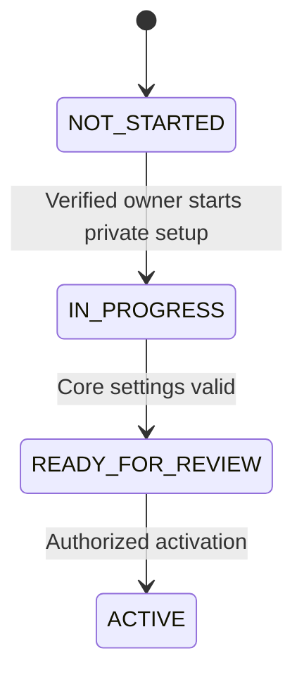

# M00.01 — SaaS workspace discovery design

## 1. Source mapping and decision/gate register

The requester confirmed ADR-025 as the scope for this design and selected the v3.2 prompt’s 12-section format. The applicable baseline is the approved v3.1.0 master. The v3.2 pack’s embedded v3.0.0 sources describe a later commerce-pilot workflow. This design concerns the industry-neutral foundation, using synthetic workspaces and WS-01 through WS-03. [ADR-025](../../../doc/CommerceOS_v3_1_Engineering_Development_Package/commerceos-execution-v3.1/MASTER_BLUEPRINT.md#235-adr-025-general-purpose-saas-foundation) · [Design prompt](../../../prompts/CommerceOS_v3_2_Prompt_Execution_Pack/prompts/M00/M00.01/01_DESIGN.md)

| Status | Decision or gate | Source and effect |
|---|---|---|
| CONFIRMED | M00.01 covers workspace creation, resumable setup, activation, invitations, workspace switching, and tenant isolation. | Master §§3, 5, 16.2, and 20, OWN-001–OWN-003, OWN-005, OWN-007, and ADR-025. |
| CONFIRMED | Workspace activation requires a verified owner, valid name, locale, time zone, and secure access. | OWN-003 and OWN-007. Branches, invitations, and optional modules may all be deferred. |
| CONFIRMED | Tenant access derives from the verified principal, selected workspace, and active membership and grants. | Master §16.2, SEC-002, and WS-02–WS-03. |
| PROPOSED | The actor, screen, ownership, and evidence walkthrough below is the M00.01 review packet. | Existing synthetic discovery examples. Detailed ownership, states, permissions, and workload decisions are reviewed in M00.02–M00.06. |
| BLOCKED | Human acceptance of the M00.01 design and RG0 signoff. | Product and Architecture review the design. RG0 covers the full M00 foundation package. |
| BLOCKED | Production identity verification method, provider, recovery, MFA configuration, and invitation delivery. | G-01 and the relevant auth and invitation work items. The walkthrough uses abstract verified, invalid, and expired inputs. |
| BLOCKED | Production capacity and retention assumptions. | G-11 and G-12. Synthetic evidence uses opaque aliases and excludes personal data. |

Pricing and entitlements, statutory treatment, payment methods, and operational providers belong to the capabilities that use them. They carry their own reviews and effective dates. Exact authorization grants, expiry/retry values, request limits, and rollout dates are unresolved for future implementation. The approved ADR-025 scope applies from 24 November 2026. [M00.01 roadmap](../../../doc/CommerceOS_v3_1_Engineering_Development_Package/commerceos-execution-v3.1/ENGINEERING_EXECUTION_ROADMAP.md#m0001--saas-workspace-discovery) · [Existing discovery packet](../../../doc/CommerceOS_v3_1_Engineering_Development_Package/commerceos-execution-v3.1/evidence/M00.01-saas-workspace-discovery.md)

## 2. User/actor journeys, permissions, and wireflow

- **Primary, WS-01.** Owner registers and verifies identity → creates a private draft → saves workspace name, locale, and time zone → signs back in and resumes the draft → reviews readiness → activates the workspace → reaches the empty home.
- **Alternate, WS-02–WS-03.** Owner invites a teammate → teammate accepts an eligible invitation and opens their allowed workspace views. A user with active memberships in two workspaces selects either workspace and sees the settings and actions granted there.
- **Reversal.** The authorized owner revokes a teammate’s membership. An already signed-in teammate loses access to that workspace at the next authorization decision. The workspace records the revocation, and access to other authorized workspaces follows their own grants. An expired or reused invitation grants no additional access.

| Actor | Tenant and field scope | Expected screens |
|---|---|---|
| Verified owner | Creates a private draft and manages name, locale, time zone, and authorized team changes in their own workspace. An owner grant in one workspace confers no grant elsewhere. | Verification, workspace selection, resumable setup, home, settings, team, audit history. |
| Administrator | Only workspace or team actions and fields covered by explicit grants. No default elevated assignment is selected by this design. | Home and the settings or team views for granted actions. |
| Invited teammate or member | Accepts an eligible invitation through the verified invite flow. After acceptance, sees only permitted fields and actions from the active membership. | Invitation status, allowed workspace views, access-denied or workspace-selection state. |
| Platform operator | Separate operator identity and authorized support scope under SEC-002. Evidence access is limited to approved records. | Authorized platform metadata and support evidence where applicable. |

Branch scope is **not applicable** to the branchless foundation fixtures. Server enforcement applies to each workspace, action, and exposed field. UI state reflects permissions and cannot grant them.

## 3. Domain model, aggregate boundaries, transitions, and invariants



The diagram follows the OWN-002 happy path. A draft can be saved and resumed. The server rechecks readiness at activation. Suspension is a separate business access condition under OWN-002. The table maps logical write ownership for review, with formal module contracts and the full state machine reserved for M00.02 and M00.03.

| Action | Preconditions and expected change | Logical write owner |
|---|---|---|
| Verify identity | Approved verification completes and establishes verified identity. Identity verification alone grants no membership. | Identity |
| Create private draft | Verified principal creates a workspace and obtains its initial owner membership through authorized operations. | Workspace owns the workspace record. Membership owns the owner grant. |
| Save or resume setup | Authorized owner saves valid setup fields. A resume reads the draft within owner scope and restores saved progress. | Configuration owns workspace settings. Onboarding owns progress. |
| Activate workspace | Current verified owner and required settings pass readiness. Workspace becomes active with optional capabilities disabled. | Workspace owns activation. Onboarding owns setup progress. |
| Issue, accept, or revoke access | Authorized owner selects a permitted role. A valid invitation grants that role once. Revocation removes the scoped membership. | Membership and access control |
| Switch workspace | Current session has an active membership in the selected workspace. Identity/session context uses the grants for that workspace. | Identity/session context, validated against Membership |
| Record privileged changes | Attributable evidence links the committed action to its actor and workspace. | Audit records the evidence from the owning domain. |

Failed verification, missing settings, expired or reused invitations, revoked access, and out-of-scope workspace operations leave protected state unchanged. Valid activation is independent of tax registration, a first sale, stock, payments, or a branch. Membership grants apply only within their own workspace.

## 4. Database entities, keys, lifecycle, migration, and backfill

**Not applicable** to M00.01. This is a documentation and approval deliverable. Physical entities, field types, tenant-safe foreign keys, unique/check constraints, indexes, migrations, and backfill belong to later implementation work.

The review uses synthetic logical records for workspace identity, display name, locale, time zone, setup progress, invitations, memberships, and audit history. Keep only the opaque aliases and expected outcomes in the review evidence. Record unresolved operational data lifecycle and retention decisions under G-12.

## 5. REST/OpenAPI, DTOs, generated clients, facades, and events

**Not applicable** to the design artifact. No REST/OpenAPI diff, generated-client change, DTO schema, status-code binding, pagination setting, facade, or event version is required for M00.01.

The walkthrough needs workspace creation and activation, setup read and save, invitation and membership changes, and a verified workspace-context switch. The master’s §18 contract conventions apply when those slices are designed. Request limits, DTO field rules, error and retry contracts, version checks, and event schema need decisions in the owning slices, including M01.03 and M02.

Illustrative review inputs for WS-01, expressed as a field map for the design walkthrough:

| Input | Expected result |
|---|---|
| Verified `OWNER-A` with `Workspace Alpha`, `en-IN`, and `Asia/Kolkata` on their private draft | Settings may be saved. Activation can proceed after readiness is confirmed. |
| Same draft with the time zone missing | Readiness fails. The draft remains private and editable by the owner. |
| A member authorized in A only supplies a reference to Beta’s settings or membership | Server authorization rejects the operation. Beta’s data and grants are unchanged. |

## 6. Transaction and consistency model, retries, and external effects

**Not applicable** to this documentation stage for runtime transactions, retry/backoff schedules, DLQ, and eventual-read implementation. The design records the outcomes that later work must preserve.

| Future operation | Expected consistency under failure |
|---|---|
| Save and activate | A failed save retains the last confirmed draft. Activation rechecks current ownership and settings. Duplicate or competing submissions cannot create conflicting activation outcomes. |
| Invite and accept | One eligible invitation yields at most one membership grant. Delivery failure is visible and grants no access. Authorized resend, delivery backoff, and invitation validity are unresolved in M00.01. |
| Revoke or switch | The server checks current membership for protected actions. Failed or rejected switching leaves the prior authorized context intact where it is still valid. Revocation is audited. |
| External side effects | Verification and invitation delivery are deferred to their owning slices. The design walkthrough and signed evidence protocol require no external service calls. |

## 7. Security threat model and second-tenant denial

| Threat | Proposed review assertion |
|---|---|
| Broken object-level authorization (BOLA) | `MEMBER-A`, with access to A only, cannot read or change Beta’s settings or memberships even when a Beta record is referenced. Verify Beta remains unchanged. |
| Broken function-level authorization (BFLA) and excessive rights | `OWNER-A` switches from owner in Alpha to member in Beta. An owner-only settings or team action in Beta is rejected. |
| Mass assignment or spoofed scope | Workspace context and grants derive from verified server context. An untrusted workspace, owner, role, or permission field cannot change that context or grant. |
| Draft or evidence leakage | A sign-out or context switch clears workspace-scoped views. Unrelated identities cannot discover the private draft. Review evidence contains synthetic aliases and redacted references. |
| Invitation replay, expiry, and revocation | Reused and expired invitations grant no additional access. Previously signed-in users lose scoped access at the next server authorization check after revocation. |
| Abuse and provider or file exposure | Auth and invite rate limits, recovery, delivery, and evidence retention remain gate-dependent. Keep credentials, invitation tokens, and personal records out of evidence and operational logs. File links are outside this design. |

Unauthorized operations must be rejected in the server path regardless of the UI. Where the later HTTP contract permits a scoped not-found response to avoid enumeration, the test checks denial and no data disclosure.

## 8. Scalability and load model

The review covers two independent tenants and a user enrolled in both. It represents isolation and role changes. Production tenant counts, request rates, hot-workspace workloads, response times, and capacity budgets are unresolved under G-11 and M00.06.

- Expected operations are workspace-scoped settings and membership reads, in-progress saves, and infrequent activation and invitation writes.
- Concurrent acceptance, revocation, and workspace switching are the primary contention cases for later tests. Keep grant decisions current and avoid a per-member query pattern for list views.
- Concrete index definitions, pagination limits, query and N+1 budgets, rate limits, tenant fairness, job memory, and worker capacity remain downstream decisions. Dedicated job processing is **not applicable** to the design artifact.

## 9. Frontend, accessibility, and screen states

| View | Reviewable behavior |
|---|---|
| Verification and sign-in | Label every input. Identify expired, invalid, and retry states through accessible text. Preserve keyboard navigation, focus order, and recovery actions. |
| Workspace setup | Show saved/in-progress state and missing fields. Convey errors next to the field and via an accessible summary. Resume only after the server verifies workspace access. |
| Home after activation | Show an honest empty state and the permitted team and settings actions. Optional capability setup appears only when relevant. |
| Invitation and team | Convey pending, accepted, expired, used, and denied outcomes with text. Keep the user on a safe screen after an expired invitation or membership revocation. |
| Workspace switcher | Show loading while the new context is verified. On success, render the selected workspace and its permitted actions. Handle failed or permission-denied switches without displaying unauthorized data. |
| Offline or stale state | Tell users when the view is stale or a save could not be confirmed. Require an authorized online action for activation and access changes. |

Check these states for keyboard access, readable focus, responsive layout, screen-reader announcements, and English/Bengali-ready text. This is a wireflow for future screens.

## 10. Automated test matrix and signed evidence inputs

Reuse the existing [synthetic tenant definitions](../../../doc/CommerceOS_v3_1_Engineering_Development_Package/commerceos-execution-v3.1/evidence/M00.01-saas-workspace-discovery.md#synthetic-tenants-and-acceptance-cases). Alpha has `OWNER-A` and locale/time zone `en-IN`/`Asia/Kolkata`. Beta has `OWNER-B` and `bn-IN`/`Etc/UTC`. `OWNER-A` is also a member in Beta. `MEMBER-A` has access to Alpha only after invitation acceptance. Keep branches and optional modules disabled. Reset scenarios independently when revocation changes the fixture.

| Test class | Scenario and fixture | Exact assertion for future verification |
|---|---|---|
| Unit | WS-01, unverified owner or invalid core settings | Activation is denied. Valid settings and verified ownership allow readiness when optional modules and invitations are deferred. |
| Real PostgreSQL integration | WS-02–WS-03, independent A and B memberships | Uniqueness and tenant scope hold through retry and revocation. A denied B mutation leaves B’s settings and memberships unchanged. |
| API contract | WS-01–WS-03, valid and invalid session/context | DTOs accept the core fields and reject an unauthorized scope or grant change. Match the documented error and verify no privileged details leak. |
| Browser E2E | WS-01, save, sign out, return, and activate | The three saved settings are restored. Alpha activates and renders an empty authorized home without setup for optional modules. |
| Concurrency | WS-02, two attempts to accept the same invitation | At most one membership grant results. Retry or replay follows the approved invitation contract. |
| Security | WS-03, `MEMBER-A` requests B and `OWNER-A` switches to their member context in B | Deny the out-of-scope read/write and the owner-only action in B. The successful Alpha change and corresponding audit remain in Alpha. |
| Load/failure | Representative workspace switching and invite or settings retries, sized under M00.06 | Confirm isolation and absence of duplicate grants under the approved workload. Confirm no successful action is shown after a failed operation. |

Runtime suites and numerical SLO verification are **not applicable** to M00.01. The design-stage evidence is a dated walkthrough with scenario ID, fixture version, actor and workspace, expected result, reviewer decision, and unresolved deviations. Attach only redacted references. The table defines future assertions.

## 11. Observability, runbook, rollout, and rollback

Design evidence records the case, synthetic actor and workspace aliases, outcome, reviewer, effective decision date, and applicable requirement or gate. Record a review deviation with its source and responsible reviewer. Keep real identity data, provider responses, credentials, and invitation contents outside the evidence.

Runtime instrumentation and flags are **not applicable** to this design. Later work should correlate workspace events and authorization outcomes without secrets, track appropriate failure and latency metrics, and define thresholds only after workload review. OWN-005 and OWN-007 keep optional capabilities disabled by default and enforce independent readiness. Apply the relevant runtime release controls when a capability is built.

For this deliverable, version the design and approval references in Git. To withdraw it, revert the design document and record the superseding decision in the review evidence.

## 12. Copyable approval checklist

```text
M00.01 design approval record
Design revision or commit:
Evidence reference:
Review date and time with offset:

[ ] Product confirms industry-neutral scope under ADR-025 and WS-01 through WS-03.
[ ] Product confirms verified owner, workspace name, locale, and time zone
    as the core setup inputs, with invitations and optional modules deferred.
[ ] Architecture confirms intended tenant scope, separate memberships,
    role differences across workspaces, and audit ownership as review inputs
    for M00.02 through M00.04.
[ ] Product and Architecture confirm the synthetic cases, including recovery,
    expired or reused invitations, revocation, and unauthorized second-tenant
    access. Record case references and any deviations.
[ ] Record G-01 as unresolved until Product and Security approve identity,
    recovery, and MFA choices. Record invitation delivery and expiry/retry
    decisions with their owning work items.
[ ] Record runtime API, schema, indexes, request limits, capacity, retention,
    entitlements, pricing, and capability policies with their later owners.
    Leave unapproved values unresolved.
[ ] Record the M00.01 design decision and date. Review RG0 separately as an
    M00 milestone gate.

Product reviewer and signature:
Architecture reviewer and signature:
Decision (APPROVED, CHANGES REQUESTED, or BLOCKED):
Conditions, unresolved choices, and evidence links:
```

STATUS: AWAITING HUMAN DESIGN APPROVAL
