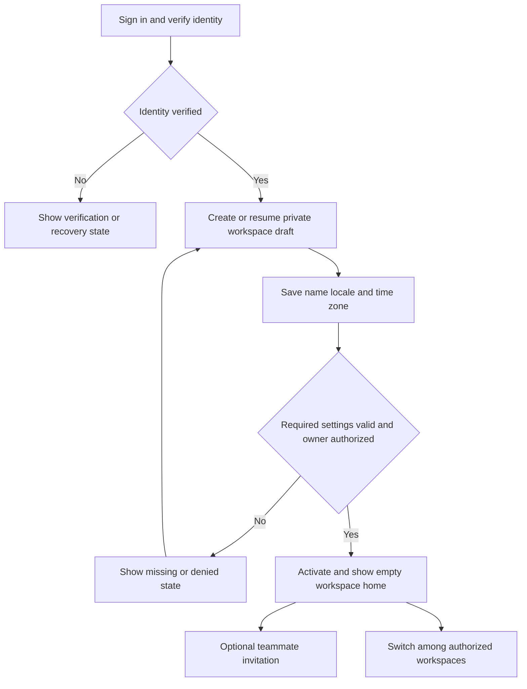

# M00.01 SaaS workspace discovery implementation evidence

## Scope and source record

This implementation delivers the review materials for the approved industry-neutral workspace design. The [human approval record](APPROVAL.md) identifies the reviewed [design revision](DESIGN.md). The requester selected ADR-025 for M00.01. The packaged prompt supplies the documentation-stage workflow. The active master supplies the scope and WS-01 through WS-03. [Implementation prompt](../../../prompts/CommerceOS_v3_2_Prompt_Execution_Pack/prompts/M00/M00.01/02_IMPLEMENT.md) · [ADR-025](../../../doc/CommerceOS_v3_1_Engineering_Development_Package/commerceos-execution-v3.1/MASTER_BLUEPRINT.md#235-adr-025-general-purpose-saas-foundation)

| Artifact | Actual change |
|---|---|
| [APPROVAL.md](APPROVAL.md) | Recorded the requester’s explicit approval, source, timestamp, and digest of the reviewed design. |
| `IMPLEMENTATION_EVIDENCE.md` | Recorded the workspace process, actor scope and screens, synthetic scenario inputs and expected outcomes, open decisions, and independent verification handoff. |

All inputs and outcomes below are synthetic review examples. Real merchant walkthroughs belong to the relevant commerce pilot under RG3.

## Workspace process



| Process | Actor and permission | Screens and evidence |
|---|---|---|
| Create or resume setup | Verified workspace owner. Only this workspace’s authorized owner can open its private draft. | Verification, workspace selection, setup progress, saved name/locale/time zone, and field-level errors. |
| Activate the workspace | Owner with valid current settings and secure access. Optional modules and invitations can be deferred. | Readiness review and empty workspace home with permitted Team and Settings actions. |
| Invite, accept, and revoke | Authorized owner grants a scoped role. Eligible invitee accepts. An authorized membership revocation removes that workspace’s access. | Invitation state, allowed team actions, membership change, access denied state, and scoped audit evidence. |
| Switch workspace | A verified identity with an active membership can select that workspace. Grants are recalculated in the selected workspace. | Loading and permission states, selected workspace name, permitted actions, and a safe return after a failed switch. |

Review each screen with keyboard navigation, visible focus, text labels, and usable error and status announcements. The synthetic workspaces have no branches. Optional branch policies belong to the work that enables them.

## Synthetic examples and negative test plans

Use the [existing fixture definitions](../../../doc/CommerceOS_v3_1_Engineering_Development_Package/commerceos-execution-v3.1/evidence/M00.01-saas-workspace-discovery.md#synthetic-tenants-and-acceptance-cases). `OWNER-A` owns Alpha and has member access in Beta. `MEMBER-A` has access to Alpha only after acceptance. Beta has its own settings, owner, members, and audit history. Reset each scenario’s membership state independently.

| Case | Inputs and sequence | Expected outcome to verify | Backlog trace |
|---|---|---|---|
| WS-01 · Create and resume | `OWNER-A` verifies identity, creates a private draft, saves `Workspace Alpha`, `en-IN`, and `Asia/Kolkata`, then signs out and resumes. All optional modules are off. | Settings survive sign-out. Readiness allows activation. The active workspace shows an empty home with owner actions. | OWN-001–OWN-003, OWN-005, OWN-007 · M02.01, M02.02, M02.05, M02.06 |
| WS-01 · Blocked activation | Attempt activation unverified or with missing time zone. Separately, try to open the draft from a different workspace’s account. | Activation is denied while either prerequisite fails. The private draft stays available only to its authorized owner. | OWN-001–OWN-003, OWN-007 · M02.01, M02.02, M02.06 |
| WS-02 · Scoped invitation | `OWNER-A` issues a member invitation to `MEMBER-A`. The invitee accepts, uses a granted action, and tries an owner-only action. | The intended member grant is applied once. The owner-only action is denied. | OWN-003, SEC-002 · M02.04, M02.09, M02.10 |
| WS-02 · Expiry, replay, and revocation | Try a separately expired invitation. Repeat an accepted invitation, then revoke membership. Use the member’s existing session for the next protected operation. | The expired and reused invitations add no grant. After revocation, the next authorization decision denies access to Alpha and the revocation remains auditable there. | OWN-003, SEC-002 · M02.04, M02.09, M02.10 |
| WS-03 · Workspace switch and scoped audit | As `OWNER-A`, perform an allowed Alpha settings change, switch to Beta, and attempt the same owner-only action there. | Alpha’s successful change is traced to Alpha. Beta shows its own settings and membership grant, and rejects the owner-only action. | Master §16.2 and SEC-002 · M02.02, M02.04, M02.10 |
| WS-03 · Second-tenant denial | In an independent fixture, `MEMBER-A` has active membership only in Alpha. Attempt a read and a write involving Beta’s settings or members. | Both operations are denied. Beta’s protected data and grants are unchanged and no protected data is returned. | Master §16.2 and SEC-001 · M02.02, M02.04, M02.10 |

These are planned checks for the owning implementation slices. Competing invite acceptance and stale context after revocation warrant later concurrency checks. Capacity and latency claims require a measured workload under M00.06 and G-11. No runtime test results are recorded for this documentation item.

## Decisions, review owners, and evidence handoff

| Item | Status and owner |
|---|---|
| M00.01 design | **APPROVED** by the project requester. The approval binds the submitted revision. |
| Independent verification | **Pending.** A human reviewer must verify the approved design, source trace, and expected outcomes. |
| RG0 | **Pending.** Product and Architecture own the milestone-level foundation design and gate review. |
| Auth and recovery (G-01) | **Unresolved.** Product and Security own verification, recovery, MFA, and related provider choices. |
| Invitation delivery and failure policy | **Unresolved.** The owning M02 invitation work item must record delivery, expiry, resend, and replay decisions. |
| Capacity and evidence retention (G-11, G-12) | **Unresolved.** Platform/Product own capacity. Privacy/Legal and Security own retention review. |
| Additional architecture decisions | ADR-025 governs this slice. The detailed ownership, transitions, and grant rules are review inputs to the later M00 items. |

Use one signed review entry per scenario or deviation:

```text
Scenario ID and fixture revision:
Design digest or link to approval:
Synthetic workspace and actor:
Expected outcome:
Review observation and any discrepancy:
Evidence link:
Decision (PASS / FAIL / BLOCKED):
Reviewer name and signature:
Review timestamp with offset:
Open condition and responsible owner:
```

## Applicability and verification boundary

| Evidence type | Assessment |
|---|---|
| Database migrations and backfill | NOT_APPLICABLE. This work item records discovery decisions and review materials. |
| API/OpenAPI, DTOs, generated clients, and events | NOT_APPLICABLE. The document describes review outcomes for later integration work. |
| Deployed telemetry | NOT_APPLICABLE. The evidence files are local documentation. |
| Application tests and load results | NOT_APPLICABLE. WS-01 through WS-03 supply inputs and planned assertions for future code. |
| Implementation-stage checks | Verified the approval digest against the reviewed design, the timestamp and linked sources, and six scenario rows covering WS-01 through WS-03. The repository diff confirmed this turn added only the two M00.01 evidence files. |

Withdrawal or correction is a documentation revision. Keep the prior approval tied to its exact design digest and record a new approval if the design changes.

STATUS: AWAITING INDEPENDENT VERIFICATION
