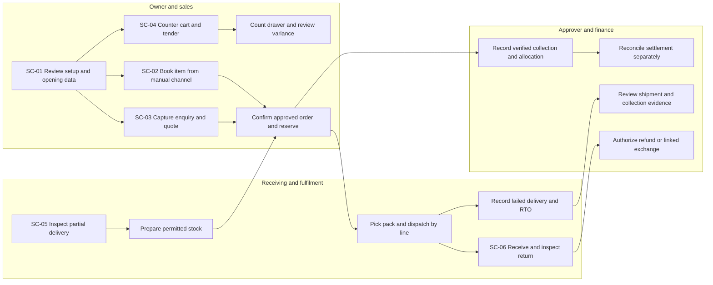

# M00.01 Business capability hypotheses and workflow mapping

## 1. Scope and capability boundaries

**Evidence class** HYPOTHESIS. Tenant A and Tenant B are fictional. The v3.3 M00.01 prompt authorizes modeling stock-tracked commerce using synthetic examples. The proposed workflows describe a capability to review. The [approved ADR-025 workspace design](../DESIGN.md) covers workspace setup, access, and isolation. This planning packet preserves that evidence and does not change its approval, activation rules, or sequencing. Product and Architecture must review how to carry both designs into the v3.3 baseline. [v3.3 prompt](../../../../prompts/CommerceOS_v3_3_General_BusinessOS_Execution_Pack/prompts/M00/M00.01.md) · [Master blueprint](../../../../prompts/CommerceOS_v3_3_General_BusinessOS_Execution_Pack/MASTER_BLUEPRINT.md) · [Scope policy](../../../../prompts/CommerceOS_v3_3_General_BusinessOS_Execution_Pack/SCOPE_AND_EVIDENCE_POLICY.md) · [Preflight reconciliation](../../../../REPOSITORY_PREFLIGHT.md#authority-and-conflicts)

| Capability | Proposed operating context |
|---|---|
| Workspace and capability setup | The owner reviews the workspace, assigns branch access where applicable, and configures enabled commerce modules. SC-01 is a synthetic commerce readiness exercise. |
| Catalog and stock | Tenant-defined typed attributes and stock-tracked items, with stock located by tenant, branch, and location. Import and receiving preserve exceptions and inventory evidence. |
| Sales and fulfilment | Manual enquiry and quotation, optional manually entered social bookings, branch counter POS, and pick, pack, dispatch, or pickup when configured. |
| Collections and returns | Scoped collection and settlement evidence, register cash close, authorized returns, inspection, and linked exchange or refund records. |
| Capabilities requiring separate approval | Service or non-stock selling, manufacturing, regulated goods, serial/lot, wholesale terms, multi-currency settlement, and merchant-sold subscriptions require approved capability contracts. Native storefront, builder, and customer checkout are deferred under MF. |

These hypotheses depend on future workspace identity/access, catalog, inventory, orders, and finance slices. Commercial entitlements, tax, default currency, and provider choices remain gated. [M00.01 work item](../../../../prompts/CommerceOS_v3_3_General_BusinessOS_Execution_Pack/WORK_ITEMS.csv) · [M00.01 roadmap](../../../../prompts/CommerceOS_v3_3_General_BusinessOS_Execution_Pack/ENGINEERING_EXECUTION_ROADMAP.md#m0001--business-capability-and-workflow-hypotheses)

## 2. Primary and alternate journeys

- **Primary.** Use Tenant A’s one-branch setup. Preview opening data, make valid stock available, create an authenticated counter sale, record mixed tender, and close the branch drawer with an independently reviewable variance. Purchasing and returns remain traceable to the owning documents.
- **Alternate.** Use Tenant B’s two-location setup and optional manual social channel. Reserve a last unit against a branch/location, convert an accepted booking, record partial advance, and track fulfilment and settlement separately. In manual sales, a quotation leaves stock unchanged until an authorized reservation or confirmation.
- **Exceptions and reversals.** An invalid import row stays rejected. A losing hold sees a conflict. An unavailable line stays blocked under the fixture policy. A before-dispatch cancellation releases its hold. After dispatch, use the permitted return or RTO route. A failed provider request leaves payment evidence pending. A damaged return goes to inspection/quarantine before any stock-cost or refund decision.

[Evidence scenarios and review inputs](PLANNING_EVIDENCE.md#scenario-and-exception-matrix) cover success, partial, conflict, denial, and replay cases for SC-01 through SC-06. The diagram is a process map; the master’s event timing and separate statuses govern future runtime designs.

## 3. Domain ownership and invariant boundaries

| Logical owner | Commands and authoritative facts | Query or integration boundary |
|---|---|---|
| Workspace, access, configuration | Verify context, scope branch grants, activate enabled setup, version policies. | Each operation derives tenant from the verified principal and validates resource, action, branch, and field scope. |
| Catalog and pricing | Define items/variants and evaluate server-side price and discount policy. | Quote and order domains consume versioned price results and store their own snapshots. |
| Inventory and reservation | Maintain stock ledger and reservations. Validate conflicts and authorize consumption/release. | Order and POS issue commands through Inventory. A reservation counts once and expiry after conversion cannot release committed stock. |
| Purchasing | Own order, receiving evidence, inspection disposition, and supplier discrepancy workflow. | Inventory posts accepted sellable quantities and quarantined disposition from authorized commands. |
| Sales and fulfilment | Own enquiry/quote/booking, order, fulfilment, and shipment records in their respective modules. | A quote does not create a hold by default in these examples. Confirm, dispatch, cancel, and return use owned commands. |
| Collections, settlement, register, and returns | Verify collection and allocation, reconcile settlement, document cash movements, and authorize RMA or linked exchange in the relevant domain. | Verified collection, order payment state, and settlement remain distinct. A sales event or delivery status cannot declare settlement. |
| Audit and read models | Preserve audit evidence and project permitted views. | Build reports from committed records, disclose freshness, and never use a read model as authority for stock or money. |

Use domain facades for cross-module commands. State changes, audit, and outbox entries follow approved transactional boundaries in later items. Candidate effect categories include stock reserved/released, order confirmed, shipment issued, collection verified, and return disposition. Their payloads, schemas, event versions, and unit-of-work boundaries remain future design work.

## 4. Persistence, migrations, and rollback

**NOT_APPLICABLE to this planning item.** No new tables, physical fields, indexes, migrations, backfill, or runtime persistence. The examples represent logical documents and ledgers only. Future slices must validate tenant-safe keys and unique operation references, decimal-safe stock quantities, configured ISO currency exponents for monetary values, and appropriate locking for competing writes.

## 5. Contracts and examples

**NOT_APPLICABLE to runtime REST/OpenAPI and generated clients.** The prompt asks for planning artifacts. Later items own exact paths, methods, DTOs, errors, idempotency keys, versions, and pagination. These examples describe conceptual operations for review.

| Operation | Valid synthetic input | Rejected or deferred input |
|---|---|---|
| Reserve stock | Verified branch actor requests one available unit from their location. | Second request for the sole unit, a stale request, or a request scoped to an unauthorized location. |
| Record collection | Authorized actor supplies separate synthetic tender evidence and an amount in the configured test money unit. | Client-set paid/settled field, missing verification evidence, or replay that would post a second collection. |
| Inspect return | Authorized receiver references an eligible delivered line and records a damaged disposition. | Quantity above eligibility or a stock increment for the damaged line. |

Future controls must make replay observable without duplicate authoritative effects and preserve versioned audit, money, and stock history.

## 6. Security and privacy

Use least privilege and separate actor authority from selling attribution. Exercise Tenant A → Tenant B denial and an unauthorized second branch within Tenant B. A cashier’s grant does not authorize a refund, settlement, or inventory adjustment. Keep cost and provider evidence fields scoped to authorized actors. The [actor matrix](PLANNING_EVIDENCE.md#actor-and-screen-matrix) identifies what each actor is expected to see or do in the fixtures.

Review object/action authorization, mass assignment, stale grants, forged collection state, invitation or operation replay, and disclosure through logs or projections. Synthetic examples use opaque aliases and contain no real identity or payment credentials. CSRF and webhook verification, signed file URLs, encryption, and concrete request rates belong to the owning runtime slices and approval gates.

## 7. Scale and recovery

The two fictional tenants are scope and exception fixtures. No workload, time target, source volume, or infrastructure budget is asserted. Hypothetical contention is two attempts for the same last unit, repeated receiving and dispatch, and duplicate payment or return evidence. The owning domains must recheck allowed state, preserve authoritative rows on rejection, and compensate through approved actions. Indexed tenant/location queries, query budgets, async fairness, backpressure, retry/backoff, and DLQ policy remain design inputs to M00.06 and the corresponding M01/domain slices under G-11.

## 8. Verification plan

Use the six [scenario cases and fixture data](PLANNING_EVIDENCE.md#scenario-and-exception-matrix) for document consistency review. Check each case traces to the master, the expected quantities and amounts reconcile, negative cases preserve tenant/branch boundaries, and no case is represented as observed or approved by an external party.

Future runtime verification includes typed contract validation, real PostgreSQL concurrency and isolation, expiry/replay handling, browser/mobile/POS E2E, authorization denials, and collection or settlement failure recovery. Those tests require implemented slices and tooling. This planning item uses static review and illustrative arithmetic checks.

## 9. Operations, accessibility, and review evidence

Plan text-labelled fields, keyboard/focus behavior, responsive layouts, and announcements for stale reads, partial operations, errors, and denied access across the screen inventory. Runtime telemetry, flags, release, disaster recovery, and migration work are **NOT_APPLICABLE** here. Later slices correlate authorized changes with redacted request and audit identifiers and gate optional capabilities on readiness. Version the planning evidence and reviewer decisions in Git. A correction or withdrawal is a documentation revert or superseding review.

## 10. Decision log and review controls

| State | Issue and owner |
|---|---|
| CONFIRMED | v3.3 planning uses fictional Tenant A/B and stock-tracked hypotheses. The applicable trace is master §§3, 5 and SC-01–SC-06. External validation is pending. |
| PROPOSED | The capability, process, actor, and screen maps are discussion inputs. Product and Architecture own review of the coverage, tradeoffs, and relationship to the ADR-025 workspace evidence. |
| BLOCKED | Additional business models and country/currency conventions require G-02/G-15/G-17. Product and the relevant Architecture, Domain, or Finance/Legal reviewers own those decisions. |
| BLOCKED | Actual external validation and commercial claims require G-16. Product/Research and QA own the research and evidence process. |
| BLOCKED | Live auth, tax, payment, fulfilment provider, or financial defaults require their owning approvals. These fixtures use symbolic providers and policies. |
| BLOCKED | Broader scope, ADR carry-forward, and RG0 signoff remain open per preflight. Runtime work and M00.02 are outside this invocation. |

Product and Architecture can record a dated decision against this packet and the [validation backlog](PLANNING_EVIDENCE.md#future-validation-backlog). Reviewer signoff and any scope reconciliation must remain attributable to the actual reviewer.
