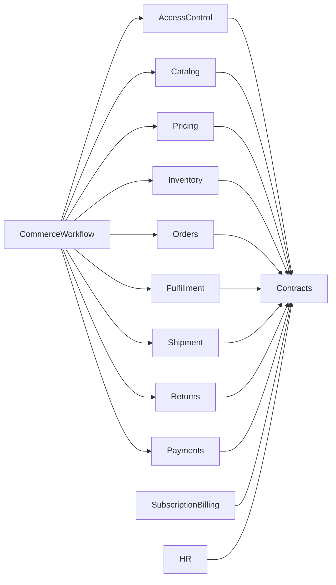

# M00.02 Domain boundaries and ownership

## 1. Scope and evidence

This is a **proposed architecture** for the stock-tracked BusinessOS capability. It traces to master §§16, 17, and 23. The requested M00.02 work is a planning review of command owners, interfaces, event routes, and mutation boundaries. The prior M00.01 [workspace approval](../M00.01/APPROVAL.md) and [v3.3 commerce hypotheses](../M00.01/v3.3/DESIGN.md) provide context. Their scopes and review statuses remain separate. Acceptance of the v3.3 integration sequence depends on prior-item review and Architecture signoff. [Master blueprint](../../../prompts/CommerceOS_v3_3_General_BusinessOS_Execution_Pack/MASTER_BLUEPRINT.md#16-technical-architecture-and-implementation-constraints) · [Work item](../../../prompts/CommerceOS_v3_3_General_BusinessOS_Execution_Pack/prompts/M00/M00.02.md) · [Execution roadmap](../../../prompts/CommerceOS_v3_3_General_BusinessOS_Execution_Pack/ENGINEERING_EXECUTION_ROADMAP.md#m0002--domain-boundaries-and-ownership)

Fictional Tenant A and Tenant B both use stock-tracked items. Branch-scoped sales and returns require approved feature access. Services, non-stock, manufacturing, regulated items and multi-currency extensions remain subject to their gates. Native storefront work is deferred. Detailed state machines, rights, and workload policy belong to M00.03, M00.04, and M00.06 respectively.

## 2. Primary and alternate journeys

A trusted application workflow receives a verified tenant/branch context, applies grants and feature constraints, then calls owner interfaces. Catalog creates a stock-tracked SKU. Inventory posts the authorized opening movement and reserves a unit. Orders confirms the draft against that commitment, retaining the order's immutable commercial snapshot. Payments verifies and allocates a synthetic collection. Fulfillment and Shipment record dispatch alongside an Inventory issue. After delivery, Returns authorizes and inspects an eligible return. Payments owns any verified monetary refund. Only Inventory may post a resulting stock disposition.

Reservation expiry runs through Inventory and releases only an active hold. A consumed hold leaves the order commitment in place. A pre-dispatch cancellation releases permitted unfulfilled commitments through Inventory. A post-dispatch case follows Returns or Shipment RTO rules. A provider timeout leaves an unresolved payment attempt for reconciliation and does not release or restock anything by itself. For SaaS Billing, an eligible fulfillment observation can feed platform usage under G-07. It cannot change merchant payment state.

## 3. Context map, command boundaries, and invariants

The arrows below are **allowed dependency directions**, from caller to public interface. An application workflow coordinates operations through the owner interfaces it imports. Shared Contracts is a leaf of types and versioned event schemas. Administrative and workforce entry points may call their own owner interfaces. They do not enter the commerce workflow by way of a private dependency.

| Owner | Public command and query intent | Private authority |
|---|---|---|
| Access Control | Resolve verified workspace and grants. Authorize actor, scope, and action. | Membership permissions, scope grants, and revocation state within the relevant identity/access module. |
| Catalog | Create item and variant. Read sellable SKU identity or a permitted catalog snapshot. | Catalog item/variant and attribute records. |
| Pricing | Resolve a price for the permitted SKU, channel, and money context. Return the result to the workflow for the order snapshot. | Price lists, price entries, and effective versions. The workflow supplies permitted SKU inputs from Catalog. Pricing has no private Catalog access. |
| Inventory and Reservation | Post opening stock, hold, convert hold to a commitment, expire/release, issue at dispatch, post inspected disposition, and query available stock. | Stock ledger, balance projection, reservations, and authoritative stock commitments. Order allocation references a commitment without owning stock quantity. |
| Orders | Draft/confirm/cancel a scoped order, record order allocation references, publish order outcome, and read eligible order lines and payment projection. | Order lines, versioned snapshots, attribution, and order status history. |
| Fulfillment and Shipment | Assign pick/pack, record approved dispatch, track separate shipment and delivery/RTO, and query coverage by line. | Fulfillment jobs, pick tasks, packages, shipments, and tracking events under their own owners. |
| Returns | Request and authorize a return, inspect a line, set disposition, authorize a refund request or exchange, and link the outcome. | RMA, inspection, exchange links, and approved store-credit adjustments. |
| Payments and Settlement | Verify merchant collections, allocate or reconcile them, execute an authorized refund, and read the outcome. | Provider evidence, merchant collections, allocations, refunds, settlements, and chargebacks. |
| SaaS Billing | Maintain versioned plans and entitlements. Record eligible usage once and process platform subscriptions, invoices, and payments. | Platform subscriptions, usage journal, counters, and platform billing records. |
| HR | Manage scoped staff, attendance, leave, and salary/payroll records. Provide a minimal staff reference where approved. | Employee and private workforce records, including immutable finalized payroll snapshots. |

Domain repositories and tables stay behind their owner interfaces, including in the same database and application transaction. For a change requiring atomic stock and order/fulfillment updates, the proposal uses a shared application transaction through declared owner interfaces. Each owner uses its own repository. The unit-of-work interface and isolation strategy require M01.04 review. No remote provider call holds a database transaction open.

**Event flow is separate from the import graph.** Owners publish facts through the outbox. A consumer validates scope, schema, ordering where applicable, and one-time effect before calling its own owner or a permitted application workflow. For example, a `payment.refunded` event can inform Returns and the order projection. It does not authorize an Inventory write. Fulfillment observations can reach Subscription Billing through Contracts without importing the fulfillment module. The owning operation defines how to handle late and repeated events.

## 4. Persistence, consistency, and migration

**NOT_APPLICABLE to implementation in M00.02.** The master §17 table names are referenced for logical ownership. This proposal does not add physical fields, indexes, or migrations. Later design must prove tenant-safe foreign keys and uniqueness, scoped branch/location references, decimal-safe quantities, configured ISO minor units, deterministic stock contention handling, and idempotent append-only effects. Audit and outbox must commit with sensitive authoritative writes. Projections can lag and must disclose freshness.

## 5. Contracts and examples

**NOT_APPLICABLE to runtime REST/OpenAPI.** There are no new routes, generated clients, or finalized schemas. The [public interface and event samples](PLANNING_EVIDENCE.md#candidate-interface-and-event-payloads) are review inputs. The master §18.4 envelope guides event correlation, versions, and replay. Exact paths, input limits, key structure, and response/error mapping belong to the owning slices.

Allowed examples are a scoped Inventory hold command or a Returns-authorized refund request sent to Payments. Rejected examples are a refund handler mutating `stock_movements`, a shared package importing a private repository, and an event that tries to override its trusted tenant scope.

## 6. Security and tenant boundaries

| Context | Required boundary |
|---|---|
| Owners and assigned branch staff | Tenant from verified membership. Authorize branch, object, action, and exposed field. A cross-tenant or out-of-branch reference cannot succeed. |
| Payment operators | Verify authoritative payment evidence before recording collections/refunds. Separate refund authorization and the actual financial write. Synthesize no paid or settled status from client fields. |
| Platform billing operators | Use platform roles, scoped merchant tenant references, and platform provider credentials. Merchant collection and settlement records stay separate. |
| Workforce operators | Enforce HR field, object, and tenant scope. Expose a minimal employee reference for attribution when authorized. Keep payroll and personal fields private. |
| Workers and integrations | Validate event scope and version against authoritative records through allowed commands. Deny replay that would apply an effect twice. Reject untrusted scope and provider evidence. |

Review BOLA/BFLA, mass assignment, spoofed payment state, replay, privileged field disclosure, and accidental cross-domain writes. Concrete CSRF, webhook, credential, encryption, and rate-limit controls belong to the actor-facing runtime slices and their approvals.

## 7. Scale and recovery

The paper cases cover one last-unit reservation, duplicate dispatch, reservation expiry after conversion, and duplicate billing usage. Future acceptance measures transaction contention on the stock position, owner-side reconciliation, and dead-letter recovery under approved workloads. Retry should preserve deterministic write ownership and use stable operation references, actor scope, event ID and aggregate versions where appropriate. Failed provider attempts become pending or reconciliation work in Payments. They do not release, issue, or restock inventory. Limits, pools, queues, and load targets remain open in G-11 and M00.06.

## 8. Verification plan

Statically trace every illustrative mutation from product creation through refund to a matching private table owner. Check a no-cycle dependency graph, explicit facade edges, and reject an injected Payments-to-Inventory write and a cyclic dependency. Record controls for duplicate dispatch, late expiry, refund restock isolation, separate SaaS usage, and tenant/branch denial using the [structured cases](PLANNING_EVIDENCE.md#structured-review-fixtures). The [verification record](VERIFICATION.md) identifies the checks that ran and the runtime checks that require later slices.

## 9. Operational and UI impact

**NOT_APPLICABLE to app delivery.** Existing shells provide workspace infrastructure. This proposal identifies which owner will eventually supply each protected action or read model. Later UIs must distinguish conflict, pending evidence, denied access, and stale projection states. Future telemetry correlates redacted actor, tenant, request, event, and operation references. No raw provider payload, salary fields, cloud selection, runtime flag, or rollout is part of M00.02.

## 10. Decision record and approval

| State | Decision or open question |
|---|---|
| CONFIRMED | ADR-003, ADR-004, and ADR-005 establish the modular monolith, scope enforcement, and Inventory stock authority. |
| CONFIRMED | ADR-008, ADR-012, ADR-013, and ADR-017 establish immutable payroll, separate commerce states, separate merchant and platform money, and reproducible usage. |
| PROPOSED | Owner interfaces and an acyclic composition layer coordinate stock/order writes without sharing private repositories. Event communication uses Contracts and explicit authorized consumer commands. |
| BLOCKED | Architecture approval of the proposed ownership and integration order, M00.01 v3.3 review, and milestone RG0 evidence are pending. |
| BLOCKED | G-04 assigns hold and return policy to Product with an external validator when available. G-05 assigns provider and payment evidence policy to Product, Finance, and Security. G-07 assigns billable usage policy to the Founder and Finance. Production timing, unsupported models, and jurisdiction rules remain gated. |

Record the candidate integration decision in the [ADR proposal](PLANNING_EVIDENCE.md#proposed-adr-register). Withdrawal is a documentation revert or superseding Architecture decision. Implementation proceeds only under the relevant reviewed work item.
